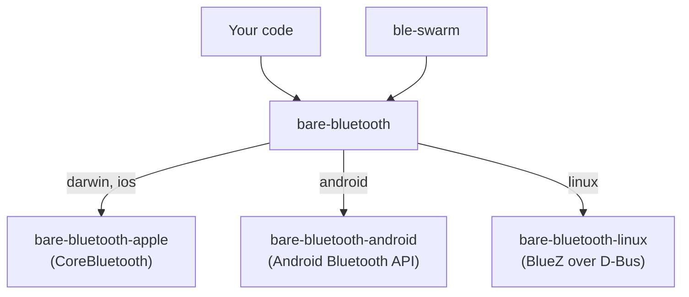

Most peer-to-peer connections in the Pear stack start on a network: [Hyperswarm](/p2p/reference/building-blocks/hyperswarm) finds peers through the DHT and holepunches a path between them. Bluetooth Low Energy (BLE) needs no network at all. Two devices within radio range can find each other and exchange data with no Wi-Fi, no internet and no server, which makes it the transport for places with no connectivity, such as a plane or a crowded venue, and a useful second path when the network is there.

This page explains how Bluetooth is put together in Bare. For working code, see the [Connect over Bluetooth](/bare/how-to/connect-over-bluetooth) guides.

## One API over three platform bindings

Every operating system exposes Bluetooth differently: CoreBluetooth on Apple platforms, the Android Bluetooth API on Android, the BlueZ daemon on Linux. Bare has one native binding per platform, and one module that puts a common API over them:

- [`bare-bluetooth`](/bare/reference/bare/modules/bare-bluetooth) picks the binding through an import map keyed on the platform, so `require('bare-bluetooth')` loads only the one for the platform it runs on. It unifies class names, state strings and constants, so consumer code needs no platform conditionals for the common cases. There is no entry for Windows, where the `require()` fails.
- [`bare-bluetooth-apple`](/bare/reference/bare/modules/bare-bluetooth-apple) wraps CoreBluetooth on macOS and iOS. Its peripheral class is CoreBluetooth's `PeripheralManager`.
- [`bare-bluetooth-android`](/bare/reference/bare/modules/bare-bluetooth-android) calls the Android Bluetooth API through JNI, plus Java helper classes it ships alongside the addon. It needs the app's Java VM, so it only runs inside an app that hosts Bare, such as a [Bare Kit](/bare/reference/bare/bare-kit) worklet.
- [`bare-bluetooth-linux`](/bare/reference/bare/modules/bare-bluetooth-linux) talks to `bluetoothd` over D-Bus, and handles L2CAP sockets itself. `bare-bluetooth` wraps it from 0.6.3.

The platform bindings stay available underneath. Their APIs follow each platform's own shape, and expose things `bare-bluetooth` leaves out; see [Use platform-specific Bluetooth features](/bare/how-to/connect-over-bluetooth/use-platform-specific-bluetooth-features).

Higher up, [`ble-swarm`](https://github.com/holepunchto/ble-swarm) builds a Hyperswarm-shaped transport on `bare-bluetooth`; see [Security](#security) below.

## Two roles: central and server

Bluetooth Low Energy is asymmetric. One side, the **peripheral**, advertises and waits; the other, the **central**, scans for advertisements and connects. `bare-bluetooth` names them after what your code does with them:

| Role | `bare-bluetooth` class | Does |
| --- | --- | --- |
| Peripheral | `Server` | Advertises, holds GATT services, answers reads and writes, publishes L2CAP channels |
| Central | `Central` | Scans, connects, and talks to the connected device through a `Peripheral` |

A device can play both roles at once, and for peer-to-peer apps it usually does: each phone advertises so others can find it, and scans so it can find others. Whoever connects first becomes the central for that connection. [`bare-mobile-doctor`'s chat](/bare/how-to/connect-over-bluetooth/build-a-bluetooth-chat-for-ios-and-android) runs a `Central` and a `Server` side by side on every phone for this reason.

## Two ways to move data: GATT and L2CAP

Once connected, there are two ways to exchange data, and they suit different jobs:

| | GATT | L2CAP channel |
| --- | --- | --- |
| Shape | Named values: services holding characteristics, each read, written or subscribed to | A byte stream, a `Duplex` you read and write |
| Size per operation | At most the ATT MTU minus 3 bytes: 20 before the MTU is negotiated up, a few hundred after | Limited only by the stream (and `mtu` per write on Linux) |
| How the other side finds it | By service and characteristic UUID | By a PSM number the operating system assigns |
| Talks to | Any BLE device, including standard ones like heart-rate monitors | Your own app on the other end |

GATT is the lingua franca of BLE: every device speaks it, and standard services have well-known UUIDs. But every value is small, and every operation is a round trip. L2CAP connection-oriented channels give you a real stream with flow control, which is what you want for messages, files or replication.

The catch with L2CAP is the PSM. CoreBluetooth and Android don't let an app choose the number its channel listens on; the operating system assigns one when you call `publishChannel()`. (On Linux, `publishChannel({ psm })` asks for a specific one, but code that also runs on Apple and Android can't rely on that.) So the other side can't know it in advance. The usual answer combines both mechanisms: advertise a service UUID so the central can find you, put the PSM in a readable GATT characteristic, and open the channel once the central has read it. `bare-mobile-doctor` works this way, and [Hand the PSM over automatically](/bare/how-to/connect-over-bluetooth/exchange-data-over-l2cap#hand-the-psm-over-automatically) shows the code. `ble-swarm` also sends the PSM over GATT, but inside a `HELLO` frame it notifies on its data characteristic.

## Everything is an event

`bare-bluetooth` has no promises. Each step, from the radio turning on to a value arriving, is an event on one of its objects, and each call starts an operation whose result comes back as an event:

Most failures follow the same rule: a failed operation arrives as an `error` event with a `code`, not as an exception. That includes a failed connection attempt and, on Apple and Android, a disconnect caused by an error, which never shows up as `disconnect`. A few failures are thrown instead: `startScan()` throws when Bluetooth isn't powered on, the Android binding throws the Java exception when a call itself fails, and the platform packages throw from calls such as `retrievePeripherals()` and `getBondedDevices()`. So the shape of a Bluetooth module in Bare is a small state machine driven by events, with `try`/`catch` around the calls, as in `bare-mobile-doctor`'s `BLECentral` and `BLEServer` classes. [Bluetooth best practices](/bare/explanation/bluetooth-best-practices) collects the rules that keep that state machine honest.

## Who is on the other end

A device's `id` means something different on each platform:

- On **Apple**, it's a UUID the system assigns per host. CoreBluetooth never reveals the device's Bluetooth address, so the same phone can show up under different ids on different hosts.
- On **Android** and **Linux**, it's the Bluetooth address, such as `AA:BB:CC:DD:EE:FF`.

Names aren't much better: on Android, `startAdvertising({ name })` can only switch the phone's own system Bluetooth name on or off, and on every platform a name may arrive late or not at all. So apps identify **what** a device is by an advertised service UUID, and **who** it is by something exchanged after connecting: a name in the first message, as in `bare-mobile-doctor`'s invite, or a public key, as in `ble-swarm`.

## Security

Bluetooth offers link-level encryption, but it comes with pairing. `publishChannel({ encrypted: true })` asks for an encrypted L2CAP channel, which requires the two devices to be paired first. On Apple and Android the operating system runs the pairing and may prompt the user; on Linux there is no system prompt, so `bare-bluetooth` emits `pairRequest` for your app to accept or reject, and only supports "just works" pairing. Pairing also authenticates devices, not people or apps: it says nothing about which key the app on the other end holds.

The alternative is to leave the link unencrypted and encrypt above it, the way the rest of the Pear stack does. `ble-swarm` publishes plain channels and runs a Noise handshake over each one, keyed by the same kind of key pair Hyperswarm uses, so each connection comes out as an encrypted, authenticated stream to a known public key, with no pairing prompt. (That is its default `l2cap` pipe; its `gatt` pipe runs the same handshake over a characteristic instead.) Its connections are the same kind Hyperswarm emits, so they plug straight into `corestore.replicate()`. `ble-swarm` is experimental upstream, like `bare-bluetooth`. It runs on macOS 13 and later, iOS and Android; it doesn't yet load the Linux binding.

## Common questions

<Accordions type="single">
<Accordion title="Can an iPhone and an Android phone talk to each other?">
Yes. Bluetooth Low Energy is the same protocol on both, and `bare-bluetooth` gives both the same API. `bare-mobile-doctor`'s chat works between any mix of iOS and Android phones. What differs is the detail: UUID casing, which events fire, how ids look. See [Bluetooth best practices](/bare/explanation/bluetooth-best-practices).
</Accordion>
<Accordion title="Can I use it with existing Bluetooth devices, not just my own app?">
Yes, through GATT. Scan for the device's standard service UUID (for example `180D` for heart rate), connect, and read or subscribe to its characteristics. L2CAP channels, by contrast, only make sense between two apps that agree on a protocol.
</Accordion>
<Accordion title="Does Bluetooth keep working when my app is in the background?">
Don't count on it. Mobile systems throttle or stop a backgrounded app's radio activity, and the Apple binding has no support for CoreBluetooth's state restoration, which iOS uses to relaunch a Bluetooth app in the background. `ble-swarm` suspends its radio work when the app goes to the background and resumes it in the foreground; [Handle app suspension](/bare/how-to/run-on-native/handle-app-suspension) covers the pattern.
</Accordion>
<Accordion title="Does it work on Windows?">
No. `bare-bluetooth` has no Windows binding, and `require('bare-bluetooth')` fails there.
</Accordion>
<Accordion title="Is bare-bluetooth peer-to-peer like Hyperswarm?">
It is the transport, not the swarm: it finds devices and opens links, and leaves identity, encryption and deciding whom to connect to to you. `ble-swarm` adds those on top, and is the closest Bluetooth equivalent to Hyperswarm.
</Accordion>
</Accordions>

## See also

- [Connect over Bluetooth](/bare/how-to/connect-over-bluetooth)—guides built on code that ships upstream.
- [Bluetooth best practices](/bare/explanation/bluetooth-best-practices)—the rules behind those guides.
- [`bare-bluetooth` reference](/bare/reference/bare/modules/bare-bluetooth)—the cross-platform API.
- [One core, many platforms](/bare/explanation/bare-on-native)—where the Bluetooth code sits in a mobile app.
- [Hyperswarm](/p2p/reference/building-blocks/hyperswarm)—peer discovery over the network.
