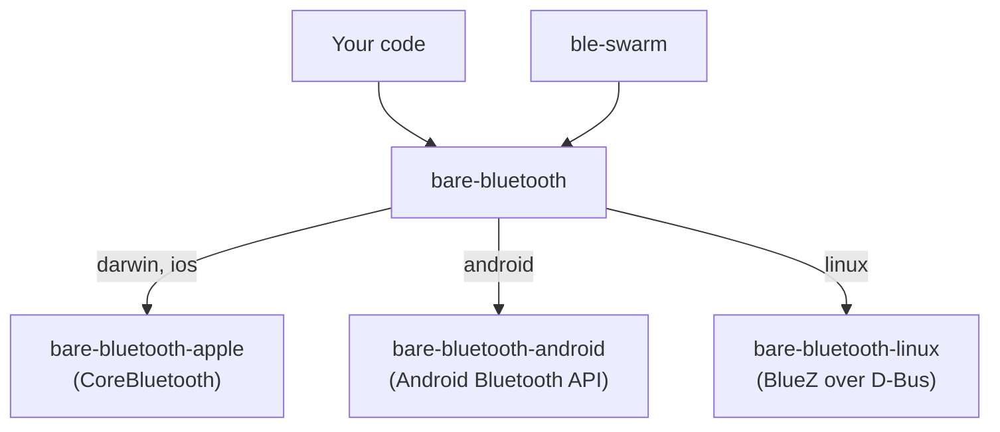

Bluetooth Low Energy (BLE) lets two devices within radio range find each other and exchange data with no Wi-Fi, no internet and no server. Most peer-to-peer connections in the Pear stack start on a network. [Hyperswarm](/p2p/reference/building-blocks/hyperswarm) finds peers through the [HyperDHT](/p2p/reference/building-blocks/hyperdht) and holepunches a path between them. Bluetooth covers two other cases:

- Places with no connectivity, such as a plane or a crowded venue.
- A second path between peers when the network is available.

This page explains how Bluetooth is put together in Bare.

<Callout type="tip">
To run working code, follow the [Connect over Bluetooth](/bare/how-to/connect-over-bluetooth) guides. To avoid the failures that only show up on real devices, read [Bluetooth best practices](/bare/explanation/bluetooth/best-practices) next.
</Callout>

## One API over three platform bindings

Each operating system exposes Bluetooth through a different API:

- Apple platforms: [CoreBluetooth](https://developer.apple.com/documentation/corebluetooth).
- Android: the [Android Bluetooth API](https://developer.android.com/develop/connectivity/bluetooth).
- Linux: the [BlueZ](https://github.com/bluez/bluez) daemon.

Bare has one native binding for each platform, and one module that puts a common API over them:

The modules do the following:

- [`bare-bluetooth`](/bare/reference/bare/modules/bare-bluetooth) picks a binding through an import map keyed on the platform, so `require('bare-bluetooth')` loads only the binding for the platform it runs on. It unifies class names, state strings and constants, so your code needs no platform conditionals for the common cases. It has no entry for Windows, where `require()` fails.
- [`bare-bluetooth-apple`](/bare/reference/bare/modules/bare-bluetooth-apple) wraps CoreBluetooth on macOS and iOS. Its [`Central`](/bare/reference/bare/modules/bare-bluetooth-apple#central) class wraps [`CBCentralManager`](https://developer.apple.com/documentation/corebluetooth/cbcentralmanager). Its peripheral class, [`PeripheralManager`](/bare/reference/bare/modules/bare-bluetooth-apple#peripheralmanager), wraps [`CBPeripheralManager`](https://developer.apple.com/documentation/corebluetooth/cbperipheralmanager).
- [`bare-bluetooth-android`](/bare/reference/bare/modules/bare-bluetooth-android) calls the Android Bluetooth API through JNI, plus Java helper classes that ship alongside the addon. It needs the app's Java VM, so it runs only inside an app that hosts Bare, such as a [Bare Kit](/bare/reference/bare/bare-kit#worklet) worklet.
- [`bare-bluetooth-linux`](/bare/reference/bare/modules/bare-bluetooth-linux) talks to `bluetoothd`, the BlueZ daemon, over [D-Bus](https://dbus.freedesktop.org/doc/dbus-tutorial.html), and handles L2CAP sockets itself. `bare-bluetooth` wraps it from 0.6.3.

The platform bindings stay available underneath. Their APIs follow each platform's own shape and expose features that `bare-bluetooth` leaves out. See [Use platform-specific Bluetooth features](/bare/how-to/connect-over-bluetooth/use-platform-specific-bluetooth-features).

Higher up, [`ble-swarm`](https://github.com/holepunchto/ble-swarm) builds a Hyperswarm-shaped transport on `bare-bluetooth`. See [Security](#security).

## Two roles: central and server

Bluetooth Low Energy is asymmetric. The **peripheral** advertises and waits. The **central** scans for advertisements and connects. `bare-bluetooth` names the roles after what your code does with them:

| Role | `bare-bluetooth` class | Does |
| --- | --- | --- |
| Peripheral | [`Server`](/bare/reference/bare/modules/bare-bluetooth#server) | Advertises, holds GATT services, answers reads and writes, publishes L2CAP channels |
| Central | [`Central`](/bare/reference/bare/modules/bare-bluetooth#central) | Scans, connects, and talks to the connected device through a [`Peripheral`](/bare/reference/bare/modules/bare-bluetooth#peripheral) |

A device can play both roles at once, and a peer-to-peer app usually does: each phone advertises so others can find it, and scans so it can find others. Whoever connects first becomes the central for that connection. The chat in [`bare-mobile-doctor`](https://github.com/holepunchto/bare-mobile-doctor) runs a `Central` and a `Server` side by side on every phone for this reason. See [Build a Bluetooth chat for iOS and Android](/bare/how-to/connect-over-bluetooth/build-a-bluetooth-chat-for-ios-and-android).

## Two ways to move data

After two devices connect, they can exchange data in two ways:

| | GATT | L2CAP channel |
| --- | --- | --- |
| Shape | Named values: services holding characteristics, each read, written or subscribed to | A byte stream: a [`Duplex`](/bare/reference/bare/modules/bare-stream#duplex) you read and write |
| Size per operation | At most the ATT MTU minus 3 bytes: 20 before the MTU is negotiated up, a few hundred after | Limited only by the stream, and by [`mtu`](/bare/reference/bare/modules/bare-bluetooth#l2capchannel) per write on Linux |
| How the other side finds it | By service and characteristic UUID | By a PSM number that the operating system assigns |
| Talks to | Any BLE device, including standard ones such as heart-rate monitors | Your own app on the other end |

GATT is the common language of BLE: every device speaks it, and standard services have well-known UUIDs. But every value is small, and every operation is a round trip. An L2CAP connection-oriented channel gives you a stream with flow control. Use it for messages, files, or replication.

The catch with L2CAP is the PSM. CoreBluetooth and Android don't let an app choose the number its channel listens on. The operating system assigns one when you call [`server.publishChannel()`](/bare/reference/bare/modules/bare-bluetooth#serverpublishchanneloptions), so the other side can't know it in advance. On Linux, `publishChannel({ psm })` asks for a specific number, but code that also runs on Apple and Android can't rely on that.

The usual solution combines both mechanisms:

1. Advertise a service UUID, so the central can find you.
2. Put the PSM in a readable GATT characteristic.
3. Open the channel after the central reads the PSM.

`bare-mobile-doctor` works this way. [Hand the PSM over automatically](/bare/how-to/connect-over-bluetooth/exchange-data-over-l2cap#hand-the-psm-over-automatically) shows the code. `ble-swarm` also sends the PSM over GATT, but inside a `HELLO` frame that it notifies on its data characteristic.

## Everything is an event

`bare-bluetooth` has no promises. Each step, from the radio turning on to a value arriving, is an event on one of its objects. Each call starts an operation, and the result comes back as an event:

The calls in this flow are [`startScan()`](/bare/reference/bare/modules/bare-bluetooth#centralstartscanserviceuuids-options), [`connect()`](/bare/reference/bare/modules/bare-bluetooth#centralconnectperipheral) and [`discoverServices()`](/bare/reference/bare/modules/bare-bluetooth#peripheraldiscoverservicesserviceuuids). The reference lists the `stateChange`, `discover` and `connect` events under [`Central`](/bare/reference/bare/modules/bare-bluetooth#central), and `servicesDiscover` under [`Peripheral`](/bare/reference/bare/modules/bare-bluetooth#peripheral).

Most failures follow the same rule: a failed operation arrives as an [`error`](/bare/reference/bare/modules/bare-bluetooth#bluetootherror) event with a `code`, not as an exception. This includes:

- A failed connection attempt.
- On Apple and Android, a disconnect that an error causes. It never shows up as [`disconnect`](/bare/reference/bare/modules/bare-bluetooth#central).

A few failures are thrown instead:

- [`startScan()`](/bare/reference/bare/modules/bare-bluetooth#centralstartscanserviceuuids-options) throws a [`BluetoothError`](/bare/reference/bare/modules/bare-bluetooth#bluetootherror) when Bluetooth isn't powered on.
- The Android binding throws the Java exception when a call itself fails.
- The platform packages throw from calls such as [`retrievePeripherals()`](/bare/reference/bare/modules/bare-bluetooth-apple#retrieveperipheralsids-string-retrievedperipheral) and [`getBondedDevices()`](/bare/reference/bare/modules/bare-bluetooth-android#getbondeddevices-device).

So a Bluetooth module in Bare is a small state machine driven by events, with `try`/`catch` around the calls. The `BLECentral` and `BLEServer` classes in `bare-mobile-doctor` follow this shape. [Bluetooth best practices](/bare/explanation/bluetooth/best-practices) collects the rules that keep the state machine honest.

## Who is on the other end

A device's [`id`](/bare/reference/bare/modules/bare-bluetooth#discoveredperipheral) means something different on each platform:

- On **Apple**, it's a UUID that the system assigns per host. CoreBluetooth never reveals the device's Bluetooth address, so the same phone can show up under different ids on different hosts.
- On **Android** and **Linux**, it's the Bluetooth address, such as `AA:BB:CC:DD:EE:FF`.

Names are no more reliable. On Android, [`startAdvertising({ name })`](/bare/reference/bare/modules/bare-bluetooth#serverstartadvertisingoptions) can only switch the phone's own system Bluetooth name on or off. On every platform, a name may arrive late or not at all. So apps identify two things separately:

- **What** a device is: an advertised service UUID.
- **Who** it is: something exchanged after connecting, such as a name in the first message (the invite in `bare-mobile-doctor`) or a public key (`ble-swarm`).

## Security

Bluetooth offers link-level encryption, but it comes with pairing. You have two options.

**Pair the devices and let Bluetooth encrypt the link.** [`server.publishChannel({ encrypted: true })`](/bare/reference/bare/modules/bare-bluetooth#serverpublishchanneloptions) asks for an encrypted L2CAP channel, which requires the two devices to be paired first.

- On Apple and Android, the operating system runs the pairing and may prompt the user.
- On Linux, there is no system prompt. `bare-bluetooth` emits a `pairRequest` event with a [`PairRequest`](/bare/reference/bare/modules/bare-bluetooth#pairrequest) for your app to accept or reject. Only "just works" pairing is supported.
- Pairing authenticates devices, not people or apps. It says nothing about which key the app on the other end holds.

**Leave the link unencrypted and encrypt on top of it,** the way the rest of the Pear stack does. `ble-swarm` publishes plain channels and runs a [Noise](https://noiseprotocol.org/) handshake over each one. The handshake uses the same kind of key pair as Hyperswarm. Each connection comes out as an encrypted, authenticated stream to a known public key, with no pairing prompt.

- The default `l2cap` pipe runs the handshake over an L2CAP channel. The `gatt` pipe runs it over a characteristic instead.
- Its connections are the same kind that Hyperswarm emits, so they plug straight into [`corestore.replicate()`](/p2p/reference/helpers/corestore#storereplicateoptsorstream).
- `ble-swarm` is experimental upstream, like `bare-bluetooth`. It runs on macOS 13 and later, iOS and Android. It doesn't yet load the Linux binding.

## Common questions

<Accordions type="single">
<Accordion title="Can an iPhone and an Android phone talk to each other?">
Yes. Bluetooth Low Energy is the same protocol on both, and [`bare-bluetooth`](/bare/reference/bare/modules/bare-bluetooth) gives both the same API. The chat in `bare-mobile-doctor` works between any mix of iOS and Android phones. The details differ in UUID casing, in which events fire, and in how ids look. See [Bluetooth best practices](/bare/explanation/bluetooth/best-practices).
</Accordion>
<Accordion title="Can I use it with existing Bluetooth devices, not just my own app?">
Yes, through GATT. Scan for the device's standard service UUID (for example, `180D` for heart rate), connect, and read or subscribe to its characteristics. See [Read, write and subscribe with GATT](/bare/how-to/connect-over-bluetooth/read-write-and-subscribe-with-gatt). L2CAP channels only make sense between two apps that agree on a protocol.
</Accordion>
<Accordion title="Does Bluetooth keep working when my app is in the background?">
Don't count on it. Mobile systems throttle or stop the radio activity of a backgrounded app. The Apple binding has no support for CoreBluetooth's state restoration, which iOS uses to relaunch a Bluetooth app in the background. `ble-swarm` suspends its radio work when the app goes to the background and resumes it in the foreground. [Handle app suspension](/bare/how-to/run-on-native/handle-app-suspension) covers the pattern.
</Accordion>
<Accordion title="Does it work on Windows?">
No. `bare-bluetooth` has no Windows binding, and `require('bare-bluetooth')` fails there.
</Accordion>
<Accordion title="Is bare-bluetooth peer-to-peer like Hyperswarm?">
`bare-bluetooth` is the transport, not the swarm. It finds devices and opens links, and leaves identity, encryption, and the choice of whom to connect to for you to handle. [`ble-swarm`](https://github.com/holepunchto/ble-swarm) adds those on top, and is the closest Bluetooth equivalent to [Hyperswarm](/p2p/reference/building-blocks/hyperswarm).
</Accordion>
</Accordions>

## See also

- [Connect over Bluetooth](/bare/how-to/connect-over-bluetooth)—guides built on code that ships upstream.
- [Bluetooth best practices](/bare/explanation/bluetooth/best-practices)—the rules behind those guides.
- [`bare-bluetooth` reference](/bare/reference/bare/modules/bare-bluetooth)—the cross-platform API.
- [One core, many platforms](/bare/explanation/bare-on-native)—where the Bluetooth code sits in a mobile app.
- [Hyperswarm](/p2p/reference/building-blocks/hyperswarm)—peer discovery over the network.
