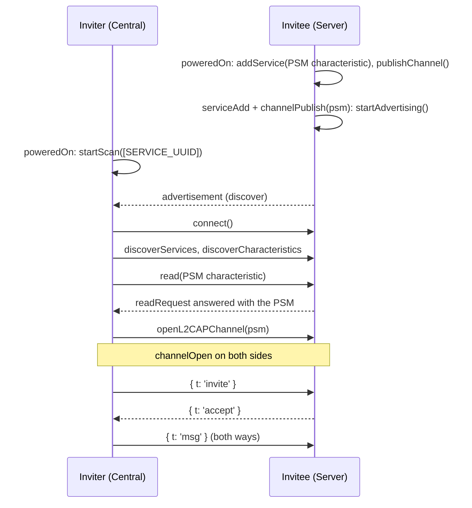

This guide walks through a working Bluetooth chat between two phones, with no network in between. The reference implementation is the Bluetooth screen of [`bare-mobile-doctor`](https://github.com/holepunchto/bare-mobile-doctor), Holepunch's diagnostics app for Bare on mobile: an Expo app in which every Bluetooth call runs in a Bare worklet through [`bare-bluetooth`](/bare/reference/bare/modules/bare-bluetooth), and the React Native screen only draws what the worklet reports.

Every phone can advertise and scan at the same time: the screen has a **Discoverable** switch and a **Scan** switch, and either phone can invite the other. You tap a nearby phone to invite it, the other side accepts, and from then on messages travel over an L2CAP channel between the two.

<Callout type="info">
`bare-bluetooth` is experimental upstream, so its API may change. This guide follows `bare-mobile-doctor` at commit [`8639c02`](https://github.com/holepunchto/bare-mobile-doctor/tree/8639c02ef626bbaf122c11b5b7e66452f4ef9b4c), which depends on `bare-bluetooth` `^0.6.2`.
</Callout>

## Before you begin

- Two physical phones, iOS or Android in any mix. Simulators and emulators can't stand in for the radio, and upstream warns that emulated Android devices can crash under QEMU.
- Android 12 (API level 31) or later: the app sets `minSdkVersion` to 31.
- The toolchain for the platforms you build: Xcode for iOS, and Android Studio with the SDK, NDK and JDK versions listed in the upstream [README](https://github.com/holepunchto/bare-mobile-doctor#android).
- The `patchelf` binary, which upstream's README asks for before `npm install`.
- Familiarity with running Bare in a React Native app, covered in [Embed Bare in a React Native app](/bare/how-to/run-on-native/embed-bare-in-react-native).

## Clone and run

```bash skip="install-instruction"
git clone https://github.com/holepunchto/bare-mobile-doctor
cd bare-mobile-doctor
npm install
npm run link
npm run bundle
```

`npm run link` links the native addons the worklets load, `bare-bluetooth` among them, into `react-native-bare-kit`; run it again after every reinstall. `npm run bundle` packs every worklet, including the Bluetooth one. If your npm config has `ignore-scripts=true`, `@shopify/react-native-skia` needs its install script run by hand; upstream's [README](https://github.com/holepunchto/bare-mobile-doctor#usage) has the command. Then build and install on each phone:

```bash skip="native-build"
npm run ios
npm run android
```

`npm run ios` is `expo run:ios`, which offers simulators as well as devices, so pick your iPhone. Installing on a physical iPhone needs a development team and provisioning profile; upstream's [iOS release build steps](https://github.com/holepunchto/bare-mobile-doctor#release-builds) walk through them in Xcode. For Android, upstream's [README](https://github.com/holepunchto/bare-mobile-doctor#android) also lists a Gradle wrapper downgrade to apply after `expo prebuild`, without which the Android build can fail.

For two Android phones, upstream recommends a release build, which doesn't need a Metro dev server per device:

```bash skip="native-build"
npx expo run:android --variant release --no-bundler
```

The release APK can then be installed on the second phone without rebuilding:

```bash skip="native-build"
adb -s <serial> install -r android/app/build/outputs/apk/release/app-release.apk
```

On both phones, open the Bluetooth screen and allow Bluetooth access when asked. Then:

1. Turn on **Discoverable** on one phone. It starts advertising.
2. Turn on **Scan** on the other. The first phone appears in the device list.
3. Tap **Invite** next to it. The first phone shows the invite; tap **Accept**.
4. Type messages on either side. **Disconnect** ends the chat on both.

## Map the code

| Path | What it is |
| --- | --- |
| [`bare/bluetooth.js`](https://github.com/holepunchto/bare-mobile-doctor/blob/8639c02ef626bbaf122c11b5b7e66452f4ef9b4c/bare/bluetooth.js) | The worklet. Owns both Bluetooth roles, the L2CAP link and the chat protocol. **This is where the Bluetooth code lives.** |
| [`app/views/bluetooth/BluetoothTests.tsx`](https://github.com/holepunchto/bare-mobile-doctor/blob/8639c02ef626bbaf122c11b5b7e66452f4ef9b4c/app/views/bluetooth/BluetoothTests.tsx) | The screen. Requests the Android permissions, starts the worklet and relays its messages to the UI. |
| [`app.json`](https://github.com/holepunchto/bare-mobile-doctor/blob/8639c02ef626bbaf122c11b5b7e66452f4ef9b4c/app.json) | The iOS usage description and the Android permissions. |
| [`scripts/link.mjs`](https://github.com/holepunchto/bare-mobile-doctor/blob/8639c02ef626bbaf122c11b5b7e66452f4ef9b4c/scripts/link.mjs) | Links the worklets' native addons. |
| `package.json` `gen:bluetooth` | Packs `bare/bluetooth.js` into `app/views/bluetooth/bluetooth.bundle.js` for every iOS and Android target. |

The platform setup (permissions, linking, bundling) is the same for any Bluetooth app and has its own guide: [Set up Bluetooth in a mobile app](/bare/how-to/connect-over-bluetooth/set-up-bluetooth-in-a-mobile-app). The rest of this page is about `bare/bluetooth.js`.

## How a chat starts

The worklet builds three objects: `BLECentral` scans and connects, `BLEServer` advertises and accepts, and `Session` runs the invite and chat protocol on top of whichever link opens first. Both phones run all three, so either one can invite the other:

```js file=<rootDir>/examples/how-to/connect-over-bluetooth/bare-mobile-doctor/bare/bluetooth.js#L679-L689 title="bare/bluetooth.js" skip="example-import"
```

Here is what happens between the inviting phone (the central) and the invited one (the server):



### 1. Wait for the radio

Nothing works until the adapter reports `'poweredOn'`: `startScan()` throws before then, and turning Bluetooth off drops the services a server has added. The central re-emits the state, and starts a scan the user asked for while the radio was still off:

```js file=<rootDir>/examples/how-to/connect-over-bluetooth/bare-mobile-doctor/bare/bluetooth.js#L125-L132 title="bare/bluetooth.js" skip="example-import"
```

The server does its setup in `_start()`, which it calls from its constructor and again on every `'poweredOn'`:

```js file=<rootDir>/examples/how-to/connect-over-bluetooth/bare-mobile-doctor/bare/bluetooth.js#L351-L357 title="bare/bluetooth.js" skip="example-import"
```

This sample has a gap. `_start()` skips `addService()` once `serviceAdded` is true and skips `publishChannel()` once it holds a PSM, and nothing resets either flag when the radio goes off. After a Bluetooth toggle, an Android phone (where `bare-bluetooth` closes the GATT server) would advertise with no service and a stale PSM. If your app has to survive that, clear both when the state leaves `'poweredOn'`, as [Bluetooth best practices](/bare/explanation/bluetooth-best-practices#wait-for-poweredon-every-time) describes.

### 2. Publish a channel and serve its PSM

An L2CAP channel is identified by a PSM number that the operating system picks when you publish it, so the other phone can't know it in advance. The server solves that with a GATT service holding one readable characteristic, `PSM_UUID`, and answers every read of it with the PSM as text:

```js file=<rootDir>/examples/how-to/connect-over-bluetooth/bare-mobile-doctor/bare/bluetooth.js#L5-L12 title="bare/bluetooth.js" skip="example-import"
```

```js file=<rootDir>/examples/how-to/connect-over-bluetooth/bare-mobile-doctor/bare/bluetooth.js#L315-L335 title="bare/bluetooth.js" skip="example-import"
```

### 3. Advertise once both are ready

A central that connects before the service exists, or before there is a PSM to read, gets nothing. So `startAdvertising()` only advertises once `serviceAdd` and `channelPublish` have both fired; until then it records the request, and those two handlers call it again:

```js file=<rootDir>/examples/how-to/connect-over-bluetooth/bare-mobile-doctor/bare/bluetooth.js#L372-L397 title="bare/bluetooth.js" skip="example-import"
```

The advertisement carries the service UUID, which is what the other phone filters its scan on.

### 4. Scan for the service

The central scans only for peripherals advertising the chat's service UUID. On Android it also passes the low-latency scan mode (the `scanOptions` constant in step 2), which is already `bare-bluetooth-android`'s default, so it only makes the choice explicit:

```js file=<rootDir>/examples/how-to/connect-over-bluetooth/bare-mobile-doctor/bare/bluetooth.js#L226-L237 title="bare/bluetooth.js" skip="example-import"
```

Every advertisement arrives as a `discover` event, often many per phone. The central keeps the latest one per `id` and reports it to the UI:

```js file=<rootDir>/examples/how-to/connect-over-bluetooth/bare-mobile-doctor/bare/bluetooth.js#L134-L143 title="bare/bluetooth.js" skip="example-import"
```

### 5. Connect, find the PSM and open the channel

Tapping **Invite** stops the scan and connects to the discovered peripheral:

```js file=<rootDir>/examples/how-to/connect-over-bluetooth/bare-mobile-doctor/bare/bluetooth.js#L255-L267 title="bare/bluetooth.js" skip="example-import"
```

Once connected, the central walks down to the PSM one event at a time: discover the service, discover its PSM characteristic, read it, and open the channel on the number it reads:

```js file=<rootDir>/examples/how-to/connect-over-bluetooth/bare-mobile-doctor/bare/bluetooth.js#L170-L224 title="bare/bluetooth.js" skip="example-import"
```

`findByUUID()` doesn't compare UUIDs with `===`. iOS reports them uppercase, Android lowercase, so both sides are normalized first:

```js file=<rootDir>/examples/how-to/connect-over-bluetooth/bare-mobile-doctor/bare/bluetooth.js#L24-L40 title="bare/bluetooth.js" skip="example-import"
```

### 6. Chat over the channel

When the channel opens, both sides get an `L2CAPChannel`, a duplex stream, and from here on there is no central or server any more. Each wraps the channel in a `PeerLink`, which frames it with [`framed-stream`](https://github.com/holepunchto/framed-stream) so every write arrives as one whole message, and sends JSON:

```js file=<rootDir>/examples/how-to/connect-over-bluetooth/bare-mobile-doctor/bare/bluetooth.js#L60-L102 title="bare/bluetooth.js" skip="example-import"
```

The chat protocol is five messages, handled in `Session.handlePeerMessage()`:

| Message | Sent by | Meaning |
| --- | --- | --- |
| `{ t: 'invite', n }` | inviter, as soon as the channel opens | "`n` wants to chat" |
| `{ t: 'accept' }` | invitee | start the chat |
| `{ t: 'reject' }` | invitee | decline; the inviter tears the link down |
| `{ t: 'msg', d }` | either | a chat message with text `d` |
| `{ t: 'disconnect' }` | either | the chat is over |

L2CAP is reliable, so a peer that closes the channel shows up as `close` or `error` on the stream, the same on both platforms. That's why `PeerLink` needs no platform-specific disconnect detection for that case. A peer that vanishes without closing the channel takes longer to notice; see [Notice a peer that has vanished](/bare/explanation/bluetooth-best-practices#notice-a-peer-that-has-vanished).

## Handle failures

On iOS and Android, a failed connection attempt, and a disconnect caused by an error, arrive as an `error` event rather than a `disconnect`. The central routes those two codes back into the session, or it would stay stuck in "connecting":

```js file=<rootDir>/examples/how-to/connect-over-bluetooth/bare-mobile-doctor/bare/bluetooth.js#L156-L167 title="bare/bluetooth.js" skip="example-import"
```

`bare-bluetooth` sets no timeout on a connection attempt either, so the session sets its own, 15 seconds, and goes back to scanning when it fires:

```js file=<rootDir>/examples/how-to/connect-over-bluetooth/bare-mobile-doctor/bare/bluetooth.js#L601-L612 title="bare/bluetooth.js" skip="example-import"
```

This timer abandons the session, but it doesn't cancel the pending connection. `BLECentral.disconnect()` only acts once a peripheral has connected, so a late `connect` can still arrive after the timeout. In your own code, call `central.disconnect()` with the object you passed to `connect()`, the way the Apple test in [Reconnect without scanning](/bare/how-to/connect-over-bluetooth/use-platform-specific-bluetooth-features#apple-reconnect-without-scanning) does.

## Tear down

Ending a chat closes the stream and drops the Bluetooth connection, whichever role this phone played:

```js file=<rootDir>/examples/how-to/connect-over-bluetooth/bare-mobile-doctor/bare/bluetooth.js#L549-L559 title="bare/bluetooth.js" skip="example-import"
```

When the user leaves the screen, the React Native side sends `disconnect` to the worklet so the other phone hears about it right away instead of waiting for the Bluetooth supervision timeout, then terminates the worklet a moment later:

```tsx file=<rootDir>/examples/how-to/connect-over-bluetooth/bare-mobile-doctor/app/views/bluetooth/BluetoothTests.tsx#L183-L196 title="app/views/bluetooth/BluetoothTests.tsx" skip="example-import"
```

<Callout type="warn">
On exit, the worklet deliberately skips `server.destroy()` and `central.destroy()`. A comment in the code says that on iOS the native module's runtime-teardown cleanup frees the same handle a second time after an explicit `destroy()`, and crashes. `bare-bluetooth-apple` fixed that cleanup in July 2026, before the comment was written, so the workaround may be out of date. Test teardown on a device before you copy it or drop it; see [Bluetooth best practices](/bare/explanation/bluetooth-best-practices#clean-up-in-the-right-order).
</Callout>

```js file=<rootDir>/examples/how-to/connect-over-bluetooth/bare-mobile-doctor/bare/bluetooth.js#L653-L666 title="bare/bluetooth.js" skip="example-import"
```

## Remix it

The channel is a plain duplex stream, so the chat is only one use of it:

| Build | Change |
| --- | --- |
| File or photo transfer | Keep `PeerLink`'s framing and send binary frames instead of JSON. |
| A protocol of your own | Replace `Session.handlePeerMessage()` and the `t` tags; the discovery and channel code stays as it is. |
| Encrypted, replicating peers | Use [`ble-swarm`](https://github.com/holepunchto/ble-swarm) instead, which runs a Noise handshake over each Bluetooth connection and hands you the same kind of encrypted stream as Hyperswarm, ready for `corestore.replicate()`. |

## Where to go next

- [Set up Bluetooth in a mobile app](/bare/how-to/connect-over-bluetooth/set-up-bluetooth-in-a-mobile-app): the permissions and build steps this app depends on.
- [Exchange data over L2CAP](/bare/how-to/connect-over-bluetooth/exchange-data-over-l2cap): the same channel from two laptops, with plain `bare`.
- [Bluetooth best practices](/bare/explanation/bluetooth-best-practices): why this code waits, normalizes and times out where it does.
- [`bare-bluetooth` reference](/bare/reference/bare/modules/bare-bluetooth): every class, event and constant.
- [Handle app suspension](/bare/how-to/run-on-native/handle-app-suspension): what to do with the radio when the app goes to the background.
