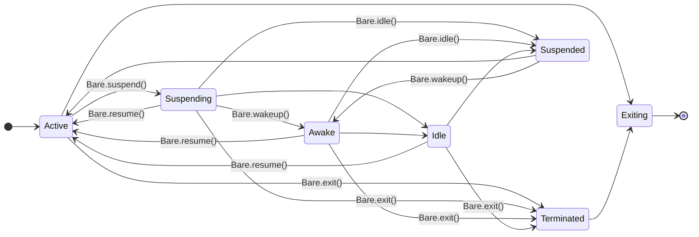

{/* Maintainer note: this page's doc-states come from src/lib/bare-runtime-docs-states.json,
generated from the typings in holepunchto/bare by scripts/gen-bare-docs-states.ts — run
`npm run gen:bare-docs-states` to refresh, then review the printed delta and add/adjust
the markers below for anything that changed. The typings are src/bare.d.ts from 1.35.0, where
the JavaScript API prose now lives as TSDoc (it was in the README), and npm/index.d.ts before
that; the npm package copies src/bare.d.ts to index.d.ts when it is packed. `Since` = added in
that release, `Until` = removed in it; pass `label` to override the badge text. Four tools, by
the size of what changed:
  <Since v="x.y.z" />                  inline badge on a sentence. Never hidden — it is the warning.
  <VersionSection since="x.y.z" />     one line directly under a heading; gates that whole section.
  <VersionGate since="x.y.z">…</…>     gates a block that is not a whole section, for example a single <Callout>.
  --flag  Description  [!version since=x.y.z]    gates one row inside a fenced help block.
This axis is independent of `bare-cli` and `bare-kit` — each Bare page tracks its own
surface, not one shared "Bare version."

Auditing a release. The printed delta is a fingerprint of signatures and deprecations, so it
cannot see a change of wording, default, or error. Check every JavaScript API statement on
this page against the TSDoc in src/bare.d.ts, then read `git diff <old> <new>` over src/,
include/, CMakeLists.txt, README.md and docs/threat-model.md. None of the C API, the compile
options, the platform table or the threat model is in the typings, so nothing in CI notices
when a release changes them. The C API reference under Embedding is written by hand from
`include/bare.h`, `include/bare/module.h` and `include/bare/target.h`: after each Bare release,
run `npm run check:bare-c-api`. It lists the functions and types the headers declare that no
page documents, and the `bare_*` names the docs use that the headers no longer declare. It
exits 0 unless passed `--strict`, and takes `--ref <tag>` to read the headers at a particular
release. Both lists are empty as of Bare 1.35.1. The embedder context page is covered by the
same check. Since 1.35.0 the README holds no API reference. Re-read its Embedding, Attaching,
Context, Suspension, Building, and Platform support sections when it changes: as of 2026-10-14
this page was audited against v1.35.1. What the README no longer says, or never said, lives
elsewhere: usage and flags on the CLI page, architecture on Inside Bare, the module list in the
Bare modules catalog.

As of 2026-10-14 the doc-state window is 1.27.0 to 1.35.0 (a rolling 5 doc-states, so 1.23.5
dropped out when 1.35.0 entered). 1.35.0 is a doc-state of its own, covering 1.35.0 and 1.35.1.
Its printed delta is `+ Addon.loaded`, `+ Addon.seal`, `+ Addon.sealed`, `+ Bare.IPC`,
`+ ThreadOptions.mount`, and the `~` signature lines that come with them and with `riscv64`
in `Bare.arch`. Only `Addon.loaded` and `ThreadOptions.mount` are new API, and both carry
`<Since v="1.35.0" />`. `Addon.seal` and `Addon.sealed` (added in 1.32.0 by holepunchto/bare#170,
badged below) and `Bare.IPC` (always there) show as additions only because the old
npm/index.d.ts never declared them. Through 1.34.1 they were documented from the README and the
threat model instead. `riscv64` was already in target.h and in the 1.34.1 README, so the
`Bare.arch` change is the typings catching up and has no marker. The rest of 1.35's news is
outside the typings and is written in prose: how a thread loads a bundle (src/bare.js
`loadThread()`, and bare-module 7.2.2 and later serving a bundle only from under its mount;
7.4.0 in the v1.35.0 lockfile), the `bare_module_find()` return type and the `wasi` and
`wasm32` macros in the headers, `BARE_ENGINE_SHARED`, libuv 1.53.0, and the threat model's
new intrinsics, WebAssembly and embedder-duty text. The npm package `bare@1.35.0` was
published without index.d.ts because the prepack script did not run; `bare@1.35.1` ships it.
As of this date there is no `bare-runtime@1.35.1`: the runtime package is at 1.35.0, which
embeds Bare 1.35.0, and 1.35.1 changed only the publish workflow and the version. Run samples
on 1.35.0.

1.33.0's real news was elsewhere: it ships `bare-module` v7.0.0 and a new module-loading
threat model (the loader no longer carries its own filesystem-read capability — an embedder
now supplies one via `Module.Protocol`). That is a `bare-module` surface change, not a `Bare`
global one, so it is documented on
[Bare modules → bare-module](/bare/reference/bare/modules/bare-module) instead of here. The
`Bare` namespace in the typings did not change from 1.32.0 through 1.34.1. 1.34's news is the C
embedding API (`bare_poll()`, `bare_attach()`, `bare_detach()` in `include/bare.h`) and the
platform floors (macOS 13.0 and iOS 15.0 as of 1.34.1). Neither is in the typings, so there
was no registered doc-state to badge them against: they are marked in prose ("From Bare
1.34.0"), like the 1.33.0 additions to the embedder context API. Do not add a Since badge for
1.34.0. The C changes of 1.35.0 are marked the same way ("From Bare 1.35.0").

1.32.0's delta is narrow: `Thread`'s constructor and `Thread.create()` gained overloads so
`source` can be passed positionally (`new Thread(filename, source[, options])`) or as a bare
callback, and `ThreadOptions.source` is newly `@deprecated` in favor of that positional form.

`Bare.Addon`/`Bare.Thread` becoming top-level siblings in 1.31.0 is a .d.ts authoring change
only — both remain reachable as `Bare.Addon`/`Bare.Thread` at runtime via the namespace
merge, so that part is not a real surface change. BUT the same commit (holepunchto/bare#172,
"Add `new Addon(url)` and deprecate existing addon APIs") also added a genuine new `Addon`
constructor and deprecated four existing members — `Addon.cache`/`.load()`/`.resolve()`,
`Thread.create()` — which IS a real, marker-worthy change and is reflected in the
`## Bare.Addon` / `## Bare.Thread` sections below with `<Since v="1.31.0" />`. The first pass at
that delta wrongly lumped the whole block in with the cosmetic rename; the giveaway missed on
first read was that `Addon.constructor` had no `-` counterpart, that is it wasn't a rename at
all. `scripts/bare-model-surface.ts`'s fingerprint was also blind to `deprecated` status at the
time (fixed since — it's now a first-class fingerprinted field, and deprecated members surface
explicitly in the printed delta, including across a rename boundary). `Bare.simulator` was
ALSO marked `@deprecated` back in 1.27.0 — left undocumented here on purpose, since it was
never described on this page to begin with and isn't worth introducing now just to badge it
deprecated.

The `Bare.versions` index-signature parameter rename (`package` -> `library`, 1.28.2) is a
type-only cosmetic change — no marker needed. `Bare.exiting`/`Bare.suspended`/
`Bare.suspending` were removed in 1.27.0 but carried no JSDoc upstream and were never
documented on this page, so there is nothing accurate to backfill with <Until> — do not
guess their semantics from the property names alone.

`Addon.resolve()` is documented below with a required `parentURL`, which the typings declare as
optional. In 1.35.0 calling it without one throws a TypeError, so the page is right and the
typings are not. It is deprecated, so it is left that way. */}

<mark style={{ backgroundColor: '#7dde9a', padding: '2px 8px', borderRadius: '4px', fontSize: '0.85em', fontWeight: 500 }}>stable</mark>

The core JavaScript API of [Bare](/bare/explanation/bare-runtime) is exposed through the global `Bare` namespace. This page documents that surface as of Bare 1.35.1. For the command-line runner, see the [`bare` CLI](/bare/reference/bare/cli). Bare provides no standard library beyond this namespace; the collection of external `bare-*` modules built for it is in [Bare modules](/bare/reference/bare/modules).

Upstream documents the namespace as TSDoc comments in [`src/bare.d.ts`](https://github.com/holepunchto/bare/blob/main/src/bare.d.ts). Before Bare 1.35.0 this documentation was in the README. The npm [`bare`](https://www.npmjs.com/package/bare) package exports the `Bare` namespace, with `Addon` and `Thread` as named exports for ESM, and ships that file as `index.d.ts`. `bare@1.35.0` was published without it, although its `package.json` points to it, so TypeScript finds no typings for that version. `bare@1.35.1` ships it. The declarations import `Duplex` from [`bare-stream`](/bare/reference/bare/modules/bare-stream) for the type of [`Bare.IPC`](#bareipc), and `bare` lists `bare-stream` as an optional peer dependency from 1.35.0.

## Process properties

#### `Bare.platform`

The operating system Bare was compiled for. One of `android`, `darwin`, `ios`, `linux`, `win32`.

#### `Bare.arch`

The processor architecture Bare was compiled for. One of `arm`, `arm64`, `ia32`, `mips`, `mipsel`, `riscv64`, `x64`.

#### `Bare.argv`

The command-line arguments passed to the process when launched.

#### `Bare.pid`

The ID of the current process.

#### `Bare.exitCode`

The code returned once the process exits. If the process exits via `Bare.exit()` without a code, `Bare.exitCode` is used. Assigned values are truncated to eight bits, so `256` becomes `0`.

#### `Bare.version`

The Bare version string, with a leading `v`, such as `v1.35.1`.

#### `Bare.versions`

An object of version strings for Bare and its dependencies, keyed by library name and without the leading `v`. It holds `bare`, `uv` for libuv, and an entry for the JavaScript engine, which is `v8` with the default engine:

```js
Bare.versions
// { bare: '1.35.1', uv: '1.53.0', v8: '14.8.178.31' }
```

## Lifecycle methods

#### `Bare.exit([code])`

Immediately terminate the process or current thread with exit status `code`, defaulting to `Bare.exitCode`. Like `Bare.exitCode`, `code` is truncated to eight bits.

#### `Bare.suspend([linger])`

Suspend the process and all threads, emitting a `suspend` event that signals all work should stop immediately. When all work has stopped and the process would otherwise exit, an `idle` event is emitted. If no listener resumes the process from that event, the loop blocks until the process is resumed, which keeps the process from exiting. `linger` is passed to `suspend` listeners and defaults to `0`.

#### `Bare.wakeup([deadline])`

Wake the process and all threads during suspension, emitting a `wakeup` event that signals work may be performed until `deadline`, a number of milliseconds that defaults to `0`. Once the process is idle, or `deadline` has passed, it suspends again and an `idle` event is emitted.

#### `Bare.idle()`

Immediately suspend the event loop and trigger the `idle` event.

#### `Bare.resume()`

Resume the process and all threads after suspension, emitting a `resume` event. May be called from a `suspend`, `wakeup`, or `idle` listener to cancel suspension, which is possible from the moment the `suspend` event is emitted until all `idle` listeners have run.

## Events

Listeners attach with `Bare.on(event, listener)`.

#### `uncaughtException`— `(err)`

A JavaScript exception was thrown within an execution context, the process or a thread, without being caught there. By default uncaught exceptions are printed to `stderr` and the process is aborted, whichever thread threw; adding a listener on that thread overrides that default, and a listener on another thread does not see the exception. If the listener itself throws, that error is reported in place of the original and the process is aborted.

#### `unhandledRejection`— `(reason, promise)`

A promise was rejected within an execution context without the rejection being handled there. The default behavior, printing to `stderr` and aborting the process, is overridden by adding a listener. An error thrown from the listener is treated as an uncaught exception, so it goes to the `uncaughtException` listeners, or aborts the process if there are none.

#### `beforeExit`— `(code)`

Emitted when the loop runs out of work, before the process or thread exits. Scheduling more work here keeps the process alive and re-arms the event. Not emitted on explicit `Bare.exit()` or an uncaught exception.

#### `exit`— `(code)`

Emitted when the process or thread exits.

<Callout type="warn">
Additional work **must not** be scheduled from an `exit` listener. If the process is forcefully terminated from within an `exit` listener, the remaining listeners do not run.
</Callout>

#### `suspend`— `(linger)`, `wakeup`— `(deadline)`, `idle`— `()`, `resume`— `()`

The lifecycle events described under [Lifecycle methods](#lifecycle-methods). Each is emitted for the process or for the current thread.

- `suspend` — the process or thread was suspended. Defer, cancel, or pause any in-progress or outstanding work, such as network activity or file system access, and schedule no additional work.
- `wakeup` — the process or thread woke up during suspension. Once it becomes idle, or if it is not idle by the time `deadline` has passed, it suspends itself again and an `idle` event is emitted.
- `idle` — the process or thread became idle after suspension. Once all listeners have run, the event loop blocks and no further work is performed until the process is resumed.
- `resume` — the process or thread resumed after suspension. Continue deferred and paused work; new work may be scheduled again.

A `suspend`, `wakeup`, or `idle` listener may call `Bare.resume()` to cancel the suspension before it completes.

## Lifecycle

Bare exposes process suspension so it can behave on platforms with strict application-lifecycle rules—mobile in particular. A suspended loop stays alive but idle rather than exiting, and can be woken for bounded bursts of work. The same transitions are available from C (`bare_suspend()`, `bare_wakeup()`, `bare_resume()`) and from JavaScript.

Suspending emits a `suspend` event. Once the loop has no work left and would otherwise exit, it emits `idle` and blocks, which keeps the process from exiting. Resuming emits `resume` and unblocks the loop, which can then exit once no work is left. While the process is suspended, the loop can be woken for limited periods to perform work, which emits `wakeup`. Each wakeup has a deadline, after which the loop is stopped and the process suspends again, emitting another `idle` event.



For the rationale, see [Inside Bare](/bare/explanation/bare-runtime#the-lifecycle); for driving it from a native host, see [One core, many platforms](/bare/explanation/bare-on-native).

## `Bare.Addon`

Loads native addons—typically C/C++ shared libraries.

<Callout type="info">
This is an advanced API most users never touch directly; native addons are normally loaded for you by the modules that need them.
</Callout>

- `new Addon(url)` <Since v="1.31.0" /> — load a static or dynamic addon from a `url` whose protocol is `builtin:`, `linked:`, or `file:`. If `url` is not a static addon, Bare looks for a matching dynamic object library instead. Returns an `addon` whose `addon.url` is the WHATWG `URL` identifier of the addon and whose `addon.exports` are its exports. Throws an `AddonError` whose `code` is `UNKNOWN_PROTOCOL` for any other protocol, or `CANNOT_LOAD` if loading fails, which includes loading a dynamic addon that the process has not already loaded once it is sealed.
- `Addon.host`— the target triplet identifying the current addon host.
- `Addon.seal()` <Since v="1.32.0" /> — freeze addon loading. Once sealed, no further dynamic addon can be loaded by the current thread or any other thread of the process, now or in the future; loading one throws. An addon that the process has already loaded can still be loaded after the seal, and `Addon.loaded()` reports whether it has. Statically linked addons are compiled in and remain available. This is one-way for the lifetime of the process, and applies to this process alone—intended for embedders that load a fixed set of trusted addons up front and then want to block any further native code, for example when building a sandbox. Embedders running several Bare processes within the same operating system process can seal each of them independently, and sealing one has no effect on the addons the others can load. Addons are owned by the process that loaded them and are unloaded when it is torn down. From Bare 1.33.0, sealing also freezes the [embedder context](/bare/reference/bare/embedder-context) registry, after which no further handles can be published. See the [threat model](https://github.com/holepunchto/bare/blob/main/docs/threat-model.md) for what sealing does and doesn't guarantee.
- `Addon.sealed` <Since v="1.32.0" /> — whether `Addon.seal()` has been called.
- `Addon.loaded(url)` <Since v="1.35.0" /> — whether the current process has already loaded the dynamic addon identified by `url`, a `URL` with the `file:` or `linked:` protocol. It loads nothing. Any other protocol, including `builtin:`, gives `false`. The answer covers every thread of the process, and it stays `true` after `Addon.seal()`. On a sealed process, `new Addon(url)` for a dynamic addon succeeds only if `Addon.loaded(url)` is `true`.
- <Until v="1.31.0" label="Deprecated in 1.31.0" /> `Addon.cache`, `Addon.load(url)`, `Addon.resolve(specifier, parentURL[, options])`— superseded by `new Addon(url)`. Still work, but new code should use the constructor.

## `Bare.Thread`

Lightweight threads with synchronous joins—similar to Node.js workers but with a minimal surface.

<Callout type="info">
This is an advanced API most users never touch directly.
</Callout>

- `Thread.isMainThread`— `true` on the main thread.
- `Thread.self`— the current thread as a `ThreadProxy`, or `null` on the main thread. `Thread.self.data` is the data passed on creation, or `null` if none was passed.
- `new Thread([filename][, options][, callback])`— start a thread that runs the source in `options.source` or, if `callback` is given, the body of `callback`, which is invoked on the new thread with `Thread.self.data` as its argument. `filename` names the source and defaults to `<thread>`. It does not say where to read the source from.
- `new Thread(callback)`, `new Thread(filename, source[, options])` <Since v="1.32.0" /> — a plain callback can be passed with no `filename`, and `source` (a string or Buffer) can be passed positionally right after `filename` instead of via `options.source`.
- <Until v="1.31.0" label="Deprecated in 1.31.0" /> `Thread.create(...)`— equivalent to `new Thread(...)`. Still works, but new code should use the constructor.
- `thread.joined`— whether the thread has been joined with the current thread.
- `thread.join()`— block and wait for the thread to exit.
- `thread.suspend([linger])`, `thread.wakeup([deadline])`, `thread.resume()`— suspend, wake, or resume the thread. Each is equivalent to calling `Bare.suspend()`, `Bare.wakeup()`, or `Bare.resume()` from within the thread.
- `thread.terminate()`— terminate the thread. Equivalent to calling `Bare.exit()` from within the thread.

The options object takes:

| Option | Default | Description |
| ------ | ------- | ----------- |
| `data` | `null` | Data to pass to the thread, available there as `Thread.self.data`. |
| `transfer` | `[]` | The transfer list for `data`. |
| `encoding` | `'utf8'` | The encoding of the source if it is a string. |
| `stackSize` | `0` | The stack size of the thread in bytes. `0` takes the default. |
| `mount` <Since v="1.35.0" /> | `filename` followed by `/` | The URL to mount the thread's bundle at, as a `URL` or a string that parses as one. The bundle serves only the modules under it, so `file:///` lets it serve any file. `null` and `undefined` take the default, and any other value throws a `TypeError`. See [Starting a thread from a bundle](#starting-a-thread-from-a-bundle). |
| `source` <Until v="1.32.0" label="Deprecated in 1.32.0" /> | | The source to run. Pass it after `filename` instead. |

A thread is loaded through a protocol that reaches nothing, so it runs only the source it was given. `filename` names that source rather than locating it, and a thread does not inherit the module protocol of the thread that spawned it. Anything else the thread needs, including the modules it imports, must travel with it as `source` or `data`. Reading a module graph off disk and handing it over is the spawner's job, so that a thread never reaches further than the code that started it. A thread given a `filename` but no source or callback has nothing to run, because it cannot read the file. It throws `MODULE_NOT_FOUND` on startup, which nothing catches, so the process aborts. From Bare 1.35.0, the one thing that protocol answers is that the native addons a bundle declares exist, as described below.

Higher-level worker threads are available in [`bare-worker`](/bare/reference/bare/modules).

### Starting a thread from a bundle

To run a module graph on a thread, bundle it with [`bare-bundle`](/bare/reference/bare/modules/bare-bundle) and pass the bundle as `source`, which is what [`bare-thread`](https://github.com/holepunchto/bare-thread) does. Give the thread a `filename` that ends in `.bundle`, such as `bare:/thread.bundle`. The extension makes Bare read `source` as a bundle, and `filename` is where the bundle is mounted by default.

The bundle serves only the modules under its mount. `options.mount` sets the mount, and without it the mount is `filename` followed by `/`, so a thread named `bare:/thread.bundle` mounts its bundle at `bare:/thread.bundle/`. A `filename` that is a path rather than a URL is read as a `file:` URL, so `/app/thread.bundle` mounts its bundle at `file:///app/thread.bundle/`. A `/` is added to the end of a mount that has none. A key that is a path in the bundle, such as `/entry.js`, is placed under the mount. A key that is an absolute URL, such as `file:///app/entry.js`, stays where it is, so the mount has to be a prefix of it. The bundles that `bare-thread` prepares from files on disk name their modules this way. A module outside the mount is not served from the bundle, and because the thread's protocol reaches nothing else, loading it throws `MODULE_NOT_FOUND`. Nothing in the thread catches that error, so the process aborts. Pass `file:///` as the mount to let the bundle serve any file.

```js
const Bundle = require('bare-bundle')

const bundle = new Bundle()

bundle.write('file:///app/dep.js', 'module.exports = "hello"')

bundle.write('file:///app/entry.js', 'console.log(require("./dep.js"))', {
  main: true,
  imports: { './dep.js': 'file:///app/dep.js' }
})

const thread = new Bare.Thread('bare:/thread.bundle', bundle.toBuffer(), {
  mount: 'file:///app/'
})

thread.join()
```

Without `mount`, this thread fails on Bare 1.35.0, because `file:///app/entry.js` is outside `bare:/thread.bundle/`.

A bundle can also declare native addons without carrying their binaries. `bare-bundle` keeps them as the bundle's `addons`. <Since v="1.35.0" /> The protocol of a thread answers that the addons a bundle declares exist, so they resolve to the paths the bundle gives and load from disk through `Bare.Addon`. `Addon.seal()` still governs that load: on a sealed process, the thread loads such an addon only if the process has already loaded it. On earlier releases the thread fails with `MODULE_NOT_FOUND` for a declared addon that the bundle does not embed.

<VersionGate since="1.35.0">
<Callout type="warn">
**Upgrading to Bare 1.35.** Bare 1.35.0 changed how a thread loads a bundle. If your code, or a library you use, starts a thread from a bundle, check these.

- Pass `mount` when the bundle holds modules outside `filename` followed by `/`, which is the case for a bundle keyed by absolute `file:` URLs. Earlier releases ignored `mount` and served a bundle's modules wherever their URLs were, so a bundle that loaded before can fail with `MODULE_NOT_FOUND` on 1.35.0. On an earlier release the option does nothing, so passing it is safe on both. The change comes from [`bare-module`](/bare/reference/bare/modules/bare-module#loading-bundles), which serves a bundle only from under its mount since 7.2.2. Bare 1.34.1 embeds `bare-module` 7.2.0 and Bare 1.35.0 embeds 7.4.0.
- The same rule applies to a bundle that your own code loads inside a thread with `Module.load()` or `Module.loadSync()`, as `bare-worker` does for the entry of a worker. Pass the `mount` option, which `bare-module` has since 7.3.0. If the bundle declares addons that it does not embed, also pass a `protocol` whose `exists()` returns `true` for their URLs. The protocol that Bare gives a thread answers only for the bundle that the thread was started with.
- `bare-thread` passes `mount` from 1.3.0 for a thread it starts from a path, and `bare-worker` passes it from 4.5.1. On Bare 1.35.0, a worker started with `bare-worker` 4.5.0 fails at startup with `Uncaught ModuleTraverseError: MODULE_NOT_FOUND` for `bare-worker/lib/worker-thread.js`. `bare-thread` 1.4.0 leaves addons out of the bundles it prepares, so a thread that loads an addon through it needs Bare 1.35.0 or later. `bare-worker` answers for the addons of a worker's own bundles from 4.5.3, so use `bare-worker` 4.5.3 or later. The other direction can fail too: on Bare 1.34.1, `bare-worker` 4.5.3 fails with `MODULE_NOT_FOUND` for the addons that its bundles declare when it resolves `bare-thread` 1.4.0, which its `^1.3.0` range allows, so move Bare and `bare-worker` together.
</Callout>
</VersionGate>

## `Bare.IPC`

Optional streaming communication between an embedder and JavaScript. Defaults to `null`, meaning no streaming channel is set. When an embedder provides one, `Bare.IPC` is expected to be an instance of a [`bare-stream`](/bare/reference/bare/modules/bare-stream) `Duplex`. The higher-level [`bare-kit`](/bare/reference/bare/bare-kit) IPC abstraction is built on this.

Unlike `Bare.Addon` and `Bare.Thread`, which cannot be replaced or deleted, `Bare.IPC` can be assigned, so that an embedder can set it. Nothing can be added to `Bare`, and the `Bare` global itself cannot be replaced.

<Callout type="info">
This is an advanced API most users never touch directly.
</Callout>

## Embedding

Bare can be embedded with the C API in [`include/bare.h`](https://github.com/holepunchto/bare/blob/main/include/bare.h):

```c
#include <bare.h>
#include <uv.h>

bare_t *bare;
bare_setup(uv_default_loop(), platform, &env /* Optional */, argc, argv, options, &bare);
bare_load(bare, filename, source, &module /* Optional */);
bare_run(bare, UV_RUN_DEFAULT);

int exit_code;
bare_teardown(bare, UV_RUN_DEFAULT, &exit_code);
```

If `source` is `NULL`, the contents of `filename` are read at runtime. For platform shells that wrap this API, see [`bare-ios`](https://github.com/holepunchto/bare-ios) and [`bare-android`](https://github.com/holepunchto/bare-android), or use [`bare-kit`](/bare/reference/bare/bare-kit), which packages embedding behind a worklet API.

From Bare 1.34.0, an embedder whose thread belongs to a host loop, such as the run loop of a user interface, drives Bare with `bare_poll()` instead of `bare_run()`. It runs the loop without blocking and reports how long the host may sleep before calling again:

```c
int timeout;
bare_poll(bare, &timeout);
```

`timeout` is in milliseconds, and may be `NULL` if the host has no use for it. A timeout of `-1` means the host may sleep until the loop's backend descriptor, as given by `uv_backend_fd()`, becomes readable. With a timeout of `0`, poll again without sleeping. `bare_poll()` returns zero once the process has exited, and sets `timeout` to `0` when it does, so check the return value rather than the timeout. Tear the process down at that point rather than polling it again.

<Callout type="warn">
Do not sleep on the timeout alone. Work can arrive from another thread while the host sleeps, and a host that waits only for the timeout to elapse does not notice it until then. Wait on the descriptor from `uv_backend_fd()` as well, and wake on whichever comes first.
</Callout>

To hand addons a native handle that only the embedder can produce, such as the Android `JavaVM *`, publish it with `bare_context_set()` before the first `bare_load()`. Values are set per process and cannot be changed once set, and every addon in the process can read what is published, so publish only what all of them may use. Addons should cope with a value that is not set. See the [embedder context API](/bare/reference/bare/embedder-context).

<Callout type="warn">
Bare is designed to be embedded alongside code the embedder may not fully trust. [`Bare.Addon.seal()`](#bareaddon) is the mechanism for freezing the set of native code a process can load. The Bare [threat model](https://github.com/holepunchto/bare/blob/main/docs/threat-model.md) sets out what sealing does and does not promise, and embedders should read it before running untrusted JavaScript. In short:

- Sealing promises only that no new native code gets in. New JavaScript can still load, and so can WebAssembly addons, which the engine runs and which reach no further than JavaScript.
- The intrinsics are shared by every module graph in a realm, and Bare does not freeze them. Untrusted code that can write to them can watch and steer other graphs, so the protocol you give it does not reliably limit it. Run untrusted code in a realm of its own, or freeze the intrinsics first.
- An embedder has five duties: check what the addons you load add up to, hand on only what you mean to, keep untrusted code away from the shared intrinsics, use an OS sandbox, and seal early and every process. Handing on covers the module protocol and anything published with `bare_context_set()`.
</Callout>

To build `libbare` for linking into an embedder, see [Building Bare](#building-bare).

### `bare_poll()`

```c
int
bare_poll(bare_t *bare, int *timeout);
```

Runs the event loop without blocking, in place of `bare_run()`, for an embedder whose thread belongs to a host loop, such as the run loop of a user interface. Requires Bare >=1.34.0.

| Parameter | Type | Description |
| --------- | ---- | ----------- |
| `bare` | `bare_t *` | The process to poll. |
| `timeout` | `int *` | Receives how long the host may sleep before polling again, in milliseconds. |

Returns zero once the process has exited, at which point it should be torn down rather than polled again.

```c
int timeout;
bare_poll(bare, &timeout);
```

A `timeout` of `-1` means that the host may sleep until the backend descriptor of the loop, as given by `uv_backend_fd()`, becomes readable. A host that sleeps on the timeout alone rather than on the descriptor misses work that arrives from another thread.

### `bare_attach()` and `bare_detach()`

```c
int
bare_attach(bare_t *bare, bare_t **previous);

int
bare_detach(bare_t *bare, bare_t *previous);
```

`bare_attach()` attaches the process to the calling thread and stores the process that was attached before in `previous`. The attached process is the one that `bare_context_get()` resolves against and that an addon loaded while attached belongs to. `bare_detach()` detaches the process and attaches `previous` in its place; a `NULL` `previous` leaves the thread attached to no process. Both return `0` on success. Requires Bare >=1.34.0.

`bare_run()` attaches the process while it runs, and so does loading an addon, so native code reached through either is already attached. A call the embedder makes itself is not, so attach the process around it:

```c
bare_t *previous;
bare_attach(bare, &previous);

js_call_function(env, receiver, fn, argc, argv, &result);

bare_detach(bare, previous);

bare_run(bare, UV_RUN_NOWAIT);
```

Attachments nest, so detach on the same thread and in the reverse order of attaching. `bare_detach()` returns `-1` if the process is not the one the thread is attached to, which is what detaching out of order looks like, and restores nothing. `bare_attach()` returns `-1` if the process has terminated or exited.

Attaching does not run the loop. The call may leave work behind that only the loop can run, which is why the example runs it once detached.

### C API reference

Everything below is declared in [`include/bare.h`](https://github.com/holepunchto/bare/blob/main/include/bare.h), except where a different header is named. Unless a function says otherwise, it returns `0` on success and a negative value on failure.

#### Setup and teardown

```c
int
bare_version(int *major, int *minor, int *patch);
```

Stores the version of the Bare that is linked in. Any of the pointers may be `NULL`. Use it when Bare is linked dynamically, where the version of the header can differ from the version of the library. For the version of the header, see [`BARE_VERSION`](#headers-and-macros).

```c
int
bare_setup(uv_loop_t *loop, js_platform_t *platform, js_env_t **env, int argc, const char *argv[], const bare_options_t *options, bare_t **result);
```

Sets up a Bare process on `loop` and stores it in `result`. `platform` is the JavaScript platform to create the environment with. If `env` is given, it receives the JavaScript environment of the process, for use with the `js_*` functions. `argc` and `argv` become `Bare.argv`, and are copied. `options` may be `NULL` for the defaults; see [`bare_options_t`](#bare_options_t). Returns a negative value on failure, in which case nothing is allocated and `result` is untouched.

```c
int
bare_load(bare_t *bare, const char *filename, const uv_buf_t *source, js_value_t **result);
```

Loads the module identified by `filename`, which may be any of the formats the module system supports; see [`bare-module`](/bare/reference/bare/modules/bare-module). If `source` is `NULL` the contents of `filename` are read from disk. Otherwise `source` must remain alive until `bare_teardown()` has returned. If `result` is given, it receives the exports of the module. The process is attached to the calling thread while the module loads.

```c
int
bare_run(bare_t *bare, uv_run_mode mode);
```

Runs the I/O event loop in `mode`, emitting `beforeExit` and `exit` as the loop runs out of work. It returns zero once the process has exited. With `UV_RUN_ONCE` or `UV_RUN_NOWAIT` it can return a non-zero value, meaning work remains and it should be called again. If the process is suspended, it does not return until another thread resumes it. To drive the loop from a host loop that owns the thread, use [`bare_poll()`](#bare_poll) instead.

`bare_poll()`, `bare_attach()` and `bare_detach()`, which require Bare `>=1.34.0`, are documented above under [`bare_poll()`](#bare_poll) and [`bare_attach()` and `bare_detach()`](#bare_attach-and-bare_detach).

```c
int
bare_teardown(bare_t *bare, uv_run_mode mode, int *exit_code);
```

Tears the process down and frees it, storing the exit code in `exit_code` if given. Do not use the JavaScript environment, or `bare`, once it has returned zero. It runs the loop in `mode` first. If handles are still open afterwards it returns a positive value and leaves `bare` valid, in which case call it again.

```c
int
bare_exit(bare_t *bare, int exit_code);
```

Immediately terminates the process with an exit status of `exit_code`. It works by calling `Bare.exit()` in the JavaScript environment, so call it from the thread that owns the environment. To terminate from any other thread, use `bare_terminate()`.

```c
int
bare_terminate(bare_t *bare);
```

Terminates the process as soon as possible. Safe to call from any thread.

#### Suspension

These are the C counterparts of [`Bare.suspend()`](#baresuspendlinger), [`Bare.wakeup()`](#barewakeupdeadline) and [`Bare.resume()`](#bareresume), and are safe to call from any thread. Each returns the result of waking the loop, so it returns a negative value only if that fails.

```c
int
bare_suspend(bare_t *bare, int linger);
```

Suspends the process as soon as possible. Once it has suspended, `bare_run()` does not return until another thread resumes the process.

```c
int
bare_wakeup(bare_t *bare, int deadline);
```

Wakes the process up if it is suspended, and gives it time until `deadline` to do background work.

```c
int
bare_resume(bare_t *bare);
```

Resumes the process as soon as possible. If the process is not yet idle after being suspended, the suspension is cancelled.

#### Sealing, context and attaching

```c
int
bare_seal(bare_t *bare);
```

Seals addon loading for the process, equivalent to [`Bare.Addon.seal()`](#bareaddon). Once sealed, the process cannot load a further dynamic addon on any of its threads, now or in the future, and statically linked addons stay available. The seal applies to the process alone and is lifted when it is torn down. It also freezes the context registry, so nothing can be published to it afterwards. Requires Bare `>=1.32.0`.

`bare_context_set()` and `bare_context_get()`, which require Bare `>=1.33.0`, and `bare_attach()` and `bare_detach()`, which require Bare `>=1.34.0`, are documented in the [embedder context API](/bare/reference/bare/embedder-context).

#### `bare_options_t`

```c
struct bare_options_s {
  int version;
  size_t memory_limit;
};
```

Options for `bare_setup()`. Set `version` to `0`, the only version there is, and any field you leave unset takes its default. A `NULL` `options` takes every default.

| Field | Since | Description |
| ----- | ----- | ----------- |
| `version` | 0 | The version of the struct. Fields newer than this version are ignored. |
| `memory_limit` | 0 | The memory limit of each JavaScript heap in bytes. The limit applies to each thread individually, including the main thread. By default it is inferred from the amount of physical memory of the device. The default can be changed at build time with `BARE_MEMORY_LIMIT`. |

#### Listeners

Each of these attaches a native listener that is the C counterpart of a JavaScript event on `Bare`. `data` is passed back to the listener as its last argument. A listener is a single slot, so a second call replaces the first, and `NULL` clears it. The event listeners run after the JavaScript listeners for the same event, and only for the main thread, not for the other threads of the process.

| Function | Listener type | Equivalent to |
| -------- | ------------- | ------------- |
| `bare_on_before_exit(bare, cb, data)` | `void (*)(bare_t *, void *data)` | `Bare.on('beforeExit', cb)` |
| `bare_on_exit(bare, cb, data)` | `void (*)(bare_t *, void *data)` | `Bare.on('exit', cb)` |
| `bare_on_suspend(bare, cb, data)` | `void (*)(bare_t *, int linger, void *data)` | `Bare.on('suspend', cb)` |
| `bare_on_wakeup(bare, cb, data)` | `void (*)(bare_t *, int deadline, void *data)` | `Bare.on('wakeup', cb)` |
| `bare_on_idle(bare, cb, data)` | `void (*)(bare_t *, void *data)` | `Bare.on('idle', cb)` |
| `bare_on_resume(bare, cb, data)` | `void (*)(bare_t *, void *data)` | `Bare.on('resume', cb)` |
| `bare_on_thread(bare, cb, data)` | `void (*)(bare_t *, js_env_t *, void *data)` | none |

The listener types are `bare_before_exit_cb`, `bare_exit_cb`, `bare_suspend_cb`, `bare_wakeup_cb`, `bare_idle_cb`, `bare_resume_cb` and `bare_thread_cb`. Unlike the others, a `bare_on_thread()` listener is called with the JavaScript environment of each thread created with the [`Thread`](#barethread) constructor, before that thread runs any JavaScript, so it is the place to modify the environment of the thread. The `beforeExit` and `exit` listeners are not passed the exit code.

#### Headers and macros

`include/bare.h` includes three more headers, available to embedders and native addons alike.

| Header | Provides |
| ------ | -------- |
| `bare/version.h` | `BARE_VERSION_MAJOR`, `BARE_VERSION_MINOR`, `BARE_VERSION_PATCH`, and `BARE_VERSION`, the version of the header as a string such as `"1.35.1"`. |
| `bare/target.h` | `BARE_PLATFORM` (`"ios"`, `"darwin"`, `"android"`, `"linux"`, `"win32"` or, from 1.35.0, `"wasi"`), `BARE_ARCH` (`"arm64"`, `"arm"`, `"x64"`, `"ia32"`, `"riscv64"`, `"mips"`, `"mipsel"` or, from 1.35.0, `"wasm32"`), `BARE_LIBC` (`"gnu"`, `"musl"` or `"bionic"`, on Linux and Android only), `BARE_SIMULATOR`, and the combined `BARE_TARGET`, equal to `BARE_HOST`. Each platform and architecture also has a matching flag, such as `BARE_PLATFORM_LINUX` or `BARE_ARCH_X64`. |
| `bare/module.h` | The native addon API below. |

From Bare 1.35.0, `bare/target.h` also recognizes a compiler that targets WebAssembly under WASI, which it detects with `__wasi__` and `__wasm32__`. It sets `BARE_PLATFORM` to `"wasi"` and `BARE_ARCH` to `"wasm32"`, and defines the flags `BARE_PLATFORM_WASI` and `BARE_ARCH_WASM32`. The [platform support](#supported-platforms) table has no WebAssembly target, and the `Bare.platform` and `Bare.arch` types in `bare.d.ts` do not list these values.

`bare/module.h` is how a native addon registers itself, which is the C side of [`Bare.Addon`](#bareaddon):

```c
BARE_MODULE(id, fn)
```

Registers the addon, where `fn` is `js_value_t *fn(js_env_t *env, js_value_t *exports)` and returns the exports. `id` is an identifier that is unique within the library, used to name the generated registration code. Define `BARE_MODULE_NAME` before including the header to name the addon, which a statically linked addon requires. A library registers one module. By default the addon registers through exported symbols that Bare looks up once the library is loaded, which suits a dynamic addon. Define `BARE_MODULE_REGISTER_CONSTRUCTOR` to register from a library constructor instead, which suits both dynamic and statically linked addons.

```c
void *
bare_module_find(const char *query);
```

Finds a loaded addon by name, optionally suffixed with `.bare`. Addons are named `<name>@<version>`, and the version may be cut off at a component boundary, so `foo@1` matches `foo@1.2.3` but not `foo@10.0.0`. A query with no version matches only an addon registered without one, and if several addons match, the most recently loaded is returned. Only the addons loaded by the process running on the calling thread are matched, along with the statically linked addons. Returns `NULL` if nothing matches or no process is running on the thread. The library belongs to Bare and must not be closed. It stays loaded for as long as the process that loaded the addon, so a caller that keeps it past the call must take a reference of its own. Before Bare 1.35.0 the function returned `uv_lib_t *`. In C, a `void *` converts to `uv_lib_t *` without a cast, so existing C code compiles unchanged. C++ code needs a cast.

```c
void
bare_module_register(bare_module_t *module);
```

Registers a module with Bare. `BARE_MODULE()` calls it for you, so you do not normally call it directly. A module registered while the thread is loading a dynamic addon becomes that addon, owned by the process doing the load. A module registered at any other time is a statically linked addon, owned by no process, available to every process including a sealed one, and registered for the life of the operating system process. `module->version` must be `BARE_MODULE_VERSION`. The module is copied, so it need not outlive the call.

### Building Bare

Bare is compiled with [`bare-make`](/bare/reference/bare/modules/bare-make). From a checkout of [`holepunchto/bare`](https://github.com/holepunchto/bare), install the tool globally, install the build and runtime dependencies, generate the build system, and build:

```console
npm i -g bare-make
npm i
bare-make generate
bare-make build
```

`bare-make generate` only has to be run once per repository checkout. After updating `bare-make` or your compiler toolchain, regenerate the build system with `bare-make generate --no-cache`, which disregards the existing build system cache.

When the build completes, the `bare(.exe)` binary is in the `build/bin` directory. The `libbare.(a|lib)` and `(lib)bare.(dylib|dll|lib)` libraries are in the root of the `build` directory.

#### Linking

When linking against the static `libbare.(a|lib)` library, use whole archive linking. Bare relies on constructor functions to register native addons, and without whole archive linking the linker removes them because nothing references them.

#### Compile options

Compile options customize aspects of the runtime. Set one by passing `--define option=value` to `bare-make generate`.

<Callout type="warn">
The compile options are not covered by semantic versioning and are subject to change without warning.
</Callout>

| Option | Default | Description |
| ------ | ------- | ----------- |
| `BARE_ENGINE` | `github:holepunchto/libjs` | The JavaScript engine to use. |
| `BARE_ENGINE_SHARED` | `OFF` | Link the JavaScript engine as a shared library rather than embedding it. Added in Bare 1.35.0. When `ON`, the prebuilds that `BARE_PREBUILDS` enables for the default engine are not used. |
| `BARE_PREBUILDS` | `ON` | Enable prebuilds for supported third-party dependencies. |
| `BARE_MEMORY_LIMIT` | `0` | The default memory limit of each JavaScript heap. See `memory_limit` in [`bare_options_t`](#bare_options_t). |

#### Sanitizers

Compile Bare with a sanitizer by passing `--sanitize` to `bare-make generate`:

```console
bare-make generate --sanitize address
```

This instruments Bare but not the JavaScript engine. To instrument the engine too, build a sanitized V8 prebuild with [`chromium-prebuilds`](https://github.com/holepunchto/chromium-prebuilds) and add `--define BARE_PREBUILDS=OFF --define GN_DIR=<src> --define GN_OUT_DIR=<out>`.

## Supported platforms

Bare sorts the platforms it targets into two tiers. **Tier 1** targets have prebuilds, as defined by the project's [`prebuild.yml`](https://github.com/holepunchto/bare/blob/main/.github/workflows/prebuild.yml) workflow, and a compilation or test failure on one fails the project's CI. **Tier 2** targets are known to work, but are not compiled or tested automatically, so a regression can slip into a release and counts as a bug. A target can move between tiers in a minor release, and that is not a breaking change.

| Platform | Architectures | Minimum | Tier | Notes |
| --- | --- | --- | --- | --- |
| Linux (glibc) | `arm64`, `x64` | Linux 5.15, GNU C Library 2.35 | 1 | Ubuntu 22.04, Debian 12, OpenWrt 23.05 |
| Linux (glibc) | `riscv64` | Linux 6.8, GNU C Library 2.39 | 2 | Ubuntu 24.04, Debian 13 |
| Linux (musl) | `arm`, `arm64`, `ia32`, `x64` | Linux 5.10, musl 1.2 | 2 | Alpine 3.13, OpenWrt 22.03 |
| Linux (musl) | `mips`, `mipsel` | Linux 5.10, musl 1.2 | 2 | OpenWrt 22.03 |
| Linux (musl) | `riscv64` | Linux 6.6, musl 1.2 | 2 | Alpine 3.20 |
| Android | `arm`, `arm64`, `ia32`, `x64` | Android 10 | 1 | |
| macOS | `arm64`, `x64` | macOS 13.0 | 1 | |
| iOS | `arm64`, `x64` | iOS 15.0 | 1 | `x64` is simulator only |
| Windows | `x64` | Windows 10 | 1 | |
| Windows | `arm64` | Windows 11 | 1 | |

Bare is developed primarily on Apple hardware, with Linux and Windows systems running as virtual machines.

The macOS and iOS minimums rose in Bare 1.34.1, from 12.0 and 14.0. A project that ships to macOS 12 or iOS 14 stays on Bare 1.34.0 or earlier. The table follows [Bare's README](https://github.com/holepunchto/bare#platform-support), which is the authority if the two ever differ.

## See also

- [Inside Bare](/bare/explanation/bare-runtime)—what the runtime adds and why.
- [Embedder context API](/bare/reference/bare/embedder-context)—pass native handles from the embedder to addons.
- [`bare` CLI](/bare/reference/bare/cli)—run scripts and start a REPL.
- [`bare-kit` reference](/bare/reference/bare/bare-kit)—embed a Bare worklet in a native app.
- [Bare modules](/bare/reference/bare/modules)—the `bare-*` standard library.
