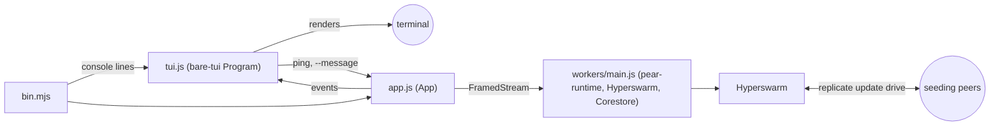

This is the terminal-UI counterpart to [Start a terminal app from the hello-pear-bare template](/p2p/getting-started/from-a-template/start-from-hello-pear-bare). It is the same boilerplate with a [`bare-tui`](https://github.com/holepunchto/bare-tui) front end: the entrypoint, the update resource, and the worker are unchanged, but instead of logging lines to stdout the app draws a full-screen interface.

[`holepunchto/hello-pear-bare-tui`](https://github.com/holepunchto/hello-pear-bare-tui) is Holepunch's official boilerplate for peer-to-peer terminal UIs. It embeds [`pear-runtime`](/pear/reference/pear/runtime) into the [Bare](/bare/reference/bare/modules) worker of a standalone executable, and compiles the application and runtime into a single binary per OS and architecture with no peer dependencies—no Node.js, and no Bare or [Pear CLI](/pear/reference/pear/cli) required on the user's machine. `bare-tui` is an Elm-style framework for Bare, after Bubble Tea: you write a model with `init`, `update`, and `view`, and a `Program` owns the screen.

<include>../../../_snippets/_p2p-intro-callout.mdx</include>

Take this path when your program is interactive and stays on screen—a dashboard, a console, a chat client—and you want it to update itself over the air. If it has no interface, or only prints lines, follow the [hello-pear-bare template](/p2p/getting-started/from-a-template/start-from-hello-pear-bare). If it also needs to run a language model on the user's machine, follow the [hello-pear-qvac-tui template](/p2p/getting-started/from-a-template/start-from-hello-pear-qvac-tui). If you want a desktop app, follow the [hello-pear-electron template](/p2p/getting-started/from-a-template/start-from-hello-pear-electron).

<include>../../../_snippets/_install-pear-cli-callout.mdx</include>

<include>../../../_snippets/_interactive-menu-callout.mdx</include>

## Clone and run

### 1. Clone the repository

You need `npm` (via [Node.js](https://nodejs.org)). The template installs Bare as a development dependency, so `npm start` runs without a global Bare. Clone the repository and install dependencies with the following commands:

```bash
git clone https://github.com/holepunchto/hello-pear-bare-tui
cd hello-pear-bare-tui
npm install
```

### 2. Create a valid `upgrade` link

The template ships with a placeholder `upgrade` link in `package.json`, and it needs a real one even when updates are off. Until you replace it, startup fails with `INVALID_URL`. Because the interface does not start in that case, the error prints as plain output. Create a real link with [`pear touch`](/pear/reference/pear/cli#pear-touch-flags):

```bash
pear touch
```

This prints a link, for example: `pear://qxenz5wmspmryjc13m9yzsqj1conqotn8fb4ocbufwtz9mtbqq5o`.

### 3. Set the `upgrade` link in `package.json`

Set the `upgrade` field in `package.json` to the link you just created:

```json
"upgrade": "pear://qxenz5wmspmryjc13m9yzsqj1conqotn8fb4ocbufwtz9mtbqq5o"
```

### 4. Run the app

`npm start` runs `bare bin.mjs --no-updates`: the app starts in development mode with over-the-air updates disabled, so a live release never swaps the binary while you work.

```bash
npm start
```

It opens a live console: a spinner header, a bordered feed of the app's log lines and the worker's messages, and a footer that lists the keys.

| Key | Does |
| --- | --- |
| `Enter` | Sends `ping` to the worker. |
| `q` or `Ctrl+C` | Quits. `q` exits with code `0`, `Ctrl+C` with `130`. |

In the feed, `‹` marks a message from the worker, `›` a message sent to it, and indented lines are the app's own log. The worker echoes anything it doesn't handle as `unknown-message <text>`, which the interface shows as `‹ worker received: <text>`, so pressing `Enter` adds `› ping` and then `‹ worker received: ping`.

Send a different message to the worker at startup (the default is `hello from tui`):

```bash
npm start -- --message "hello from dev"
```

To exercise the updater locally, opt back in:

```bash
npm start -- --updates
```

### When there is no interface

The interface starts only when both stdin and stdout are a terminal and the `upgrade` link is valid. Otherwise the app runs exactly like hello-pear-bare and prints plain lines:

- **Piped or redirected output**, such as `npm start | cat` or a CI run. `--message` is accepted but not sent, because there is no interface to send it from. A signal exits with `130`, `129`, `131`, or `143` for `SIGINT`, `SIGHUP`, `SIGQUIT`, or `SIGTERM`.
- **An invalid `upgrade` link.** The worker throws on one, and an uncaught worker error aborts the process before the interface could restore the terminal, so the interface stays off and the error is readable.

<Callout type="info">
If the screen looks garbled after a crash, run `reset`. The interface restores the terminal on a normal exit, an error, and a signal, but not after `SIGKILL` or an uncaught error in the worker.
</Callout>

## Map the template

| Path | What it is | Do you edit it? |
| --- | --- | --- |
| [`tui.js`](https://github.com/holepunchto/hello-pear-bare-tui/blob/main/tui.js) | The interface: a `bare-tui` model (`init`, `update`, `view`) and the glue that connects it to `bin.mjs` and the `App`. | Yes—replace this first. |
| [`bin.mjs`](https://github.com/holepunchto/hello-pear-bare-tui/blob/main/bin.mjs) | The entrypoint—parses CLI flags, resolves the storage path, starts the interface, constructs the `App`, and logs its updater events. | Yes—your startup and CLI. |
| [`app.js`](https://github.com/holepunchto/hello-pear-bare-tui/blob/main/app.js) | The `App` class (a [`ready-resource`](https://github.com/holepunchto/ready-resource)). Spawns the Bare worker with [`PearRuntime.run`](/pear/reference/pear/runtime#running-workers), wraps its IPC in a [`FramedStream`](https://www.npmjs.com/package/framed-stream), and turns updater messages into events. Identical to hello-pear-bare. | Sometimes—app lifecycle. |
| [`workers/main.js`](https://github.com/holepunchto/hello-pear-bare-tui/blob/main/workers/main.js) | The Bare [worker](/pear/explanation/workers) that owns the peer-to-peer code and the `pear-runtime` updater. Its source is inlined from [`hello-pear-worker`](https://github.com/holepunchto/hello-pear-worker). Identical to hello-pear-bare. | Yes—this is your backend. |
| [`package.json`](https://github.com/holepunchto/hello-pear-bare-tui/blob/main/package.json) | App metadata, scripts (including `inline-worker`), the `upgrade` link, and the per-platform `make:*` build targets. | Yes—branding and release link. |
| [`scripts/make.js`](https://github.com/holepunchto/hello-pear-bare-tui/blob/main/scripts/make.js) | The `npm run make` builder—runs [`bare-build`](https://github.com/holepunchto/bare-build) for the host OS and architecture (or the target in `HOST`), and signs the binary when signing credentials are set. | Rarely. |
| [`test/index.js`](https://github.com/holepunchto/hello-pear-bare-tui/blob/main/test/index.js) | Headless [`brittle`](https://github.com/holepunchto/brittle) tests for the interface model, run by `npm test`. | Yes—your tests. |

The peer-to-peer logic still lives in a Bare [worker](/pear/explanation/workers), as in the other templates. Your "frontend" is `tui.js`.

## How it's wired

`bin.mjs` is hello-pear-bare's entrypoint plus an `import TUI from './tui.js'`, a `--message` flag, and three lines that hand its output to the interface:

```js
const tui = TUI.start({ name: appName, upgrade: pkg.upgrade, message: cmd.flags.message })
const console = tui ? tui.console : globalThis.console
tui?.attach(app)
```

`TUI.start()` returns `null` when there is no terminal or the `upgrade` link is invalid—see [When there is no interface](#when-there-is-no-interface)—and `bin.mjs` then logs to the real console. Otherwise it returns a running interface, and the rest of `bin.mjs` logs to `tui.console`.



The interface owns the screen, so nothing may print to stdout while it runs. `tui.console` takes each line `bin.mjs` would print and puts it in the feed instead. `attach(app)` then connects the interface and the `App`:

- The worker's messages (the `App`'s `message` event) show as worker lines.
- The `--message` text is sent to the worker once the `App` is ready, and `Enter` sends `ping`, both over the `App`'s IPC pipe.
- Quitting the interface closes the `App`, and closing the `App`—on a signal or a failed startup—quits the interface.

The model in `tui.js` receives these messages:

| Message | Source |
| --- | --- |
| `{ type: 'log', level, line }` | A line `bin.mjs` printed. |
| `{ type: 'worker', data }` | A message from the worker. |
| `{ type: 'key' }` and `{ type: 'resize' }` | Terminal input and window size, from `bare-tui`. |

<Callout type="warn">
The worker shares the terminal with the interface, so it must report over IPC (`pipe.write(...)`) and never call `console.log` or `console.error`. Anything it prints goes straight onto the screen and garbles the interface.
</Callout>

## Updates

Updates work as in [hello-pear-bare](/p2p/getting-started/from-a-template/start-from-hello-pear-bare#how-its-wired). The worker owns the `pear-runtime` updater and messages the host, and `App` turns those messages into `updating`, `updated`, and `update-applied` events, applying each downloaded release automatically. `bin.mjs` logs them, and the interface shows them in the feed as `[updater]` lines. For the model behind these updates, see [Pear OTA](/pear/reference/pear/runtime#updates).

Development runs start with `--no-updates` so a live release never replaces the binary while you iterate. Disable updates for one run of a standalone build the same way:

```bash
./out/make/hello-pear-bare-tui --no-updates
```

## Build a standalone binary

`npm run make` compiles `bin.mjs` and its dependencies into a single standalone executable with no peer dependencies. `scripts/make.js` detects your OS and architecture and writes the binary to `out/make`, named after `productName || name` from `package.json` (`hello-pear-bare-tui`, plus `.exe` on Windows). The template supports macOS, Linux, and Windows, each for `arm64`/`x64`. To build for a different supported target, set `HOST`:

```bash
HOST=linux-arm64 npm run make
```

`npm run make` signs the binary when signing credentials are in the environment—the same ones the [`make-pear-app`](/pear/reference/ci-and-release/github-actions#make-pear-app) GitHub Action provides. With none of them set, the binary is unsigned:

| Variable | Platform | What it does |
| --- | --- | --- |
| `MAC_CODESIGN_IDENTITY` | macOS | Signs the executable with this identity and the hardened runtime. |
| `KEYCHAIN_PROFILE` | macOS | Also submits the signed executable to Apple's notary service with `xcrun notarytool`, using this keychain profile, and waits for the result. Set it together with `MAC_CODESIGN_IDENTITY`. |
| `WINDOWS_CERT_SHA1` | Windows | Signs the executable with the certificate that has this SHA-1 thumbprint, using `signtool.exe` from the Windows 10 SDK. |

The per-platform `make:<platform>-<arch>` scripts in `package.json` are still there for one-off builds. Each one builds an **unsigned** binary into `out/<platform>-<arch>`.

See [Bundle a Bare app](/bare/how-to/run-on-native/bundle-a-bare-app#standalone-executable-with-bare-build) for what `npm run make` runs under the hood—[`bare-build`](https://github.com/holepunchto/bare-build), the same tool behind any standalone Bare executable, Pear app or not.

## Install over the air

Distribute the executable through the usual channels—a download on your website, `apt`, or Homebrew.
You can also install it peer-to-peer: once your `upgrade` link is [seeding](/pear/explanation/availability-and-blind-peering#seeding-with-pear-seed) a release, pull it directly with the [`pear install`](/pear/reference/pear/cli#pear-install) command:

```bash
pear install pear://<key>
```

After the first install, new releases reach users through the swarm—no reinstall needed. For how staging and seeding work, see [Deploy your application](/pear/how-to/operate-an-app/manual-deployment/deployment) and [Installing applications](/pear/explanation/storage-and-distribution#installing-applications).

## Example: add a key

The boilerplate is a minimal live console; `tui.js` holds the interface. The model's `update(msg)` handles each key, so adding one is a few lines. Add a `c` key that clears the feed, in the `key` case next to the `q` handler:

```diff
         if (key.matches(msg, 'q')) return [this, quit]
+        if (key.matches(msg, 'c')) {
+          this.feed = []
+          return [this, null]
+        }
         if (key.matches(msg, 'ctrl+c')) {
```

Then list it in the footer, in `view()`:

```diff
-    const footer = style().faint(true).render(' enter ping · q quit')
+    const footer = style().faint(true).render(' enter ping · c clear · q quit')
```

The template's first test asserts the footer text, so update `includes('enter ping · q quit')` in `test/index.js` to match, and add a test for the key. Models are plain objects, so `npm test` exercises them headless, with no terminal:

```js
test('c clears the feed', (t) => {
  const tui = create()
  tui.update(log('one'))
  tui.update(worker('Hello from worker'))
  t.is(tui.feed.length, 2)
  tui.update(press('c'))
  t.is(tui.feed.length, 0)
})
```

That is the interface layer. To build a different one, replace the model in `tui.js`; see the [`bare-tui` documentation](https://github.com/holepunchto/bare-tui) for its components (`list`, `table`, `textinput`, `viewport`, `progress`), `style`, and layout. Your real peer-to-peer features go in the [worker](/pear/explanation/workers) (`workers/main.js`):

* open a [Corestore](/p2p/reference/helpers/corestore) core,
* join a [Hyperswarm](/p2p/reference/building-blocks/hyperswarm) topic, and
* run your protocol, reporting results to the interface over IPC.

Reuse the storage directory the host passes to the worker so your data lands alongside the updater's—see [Storage and distribution](/pear/explanation/storage-and-distribution).

## Customize for your brand

Before you ship, set your identity in `package.json`:

- `name`, `productName`, `description`, `author`, and `license`.
- the `upgrade` `pear://` link (see [Create a valid upgrade link](#2-create-a-valid-upgrade-link)).

`bin.mjs` reads `productName || name` for both the binary name and the persistent storage directory, so set these before your first release. Then build with `npm run make` and release with [Deploy your application](/pear/how-to/operate-an-app/manual-deployment/deployment).

## Where to go next

- [Start from a template](/p2p/getting-started/from-a-template)—all the boilerplates, side by side.
- [Start a terminal app from the hello-pear-bare template](/p2p/getting-started/from-a-template/start-from-hello-pear-bare)—the same template without the interface, which logs to stdout.
- [Start an on-device AI terminal app from the hello-pear-qvac-tui template](/p2p/getting-started/from-a-template/start-from-hello-pear-qvac-tui)—a terminal interface with a second worker that runs a language model locally.
- [Start from the hello-pear-electron template](/p2p/getting-started/from-a-template/start-from-hello-pear-electron)—the desktop counterpart, with a renderer, preload bridge, and Bare worker.
- [Inside Bare](/bare/explanation/bare-runtime)—what the runtime this template builds on actually is, and its lifecycle.
- [Runtime and languages](/pear/explanation/runtime-and-languages)—where Bare fits among Pear's runtimes.
- [Bundle a Bare app](/bare/how-to/run-on-native/bundle-a-bare-app)—the `bare-pack` and `bare-build` paths behind `npm run make`.
- [Pear OTA](/pear/reference/pear/runtime)—the `pear-runtime` API behind the updater.
- [Publish with GitHub Actions](/pear/how-to/operate-an-app/github-actions/publish-with-github-actions)—stage a stable `pear://` link on every push with the `pear-ci` action.
- [Deploy your application](/pear/how-to/operate-an-app/manual-deployment/deployment)—the full-control manual path for staging, provisioning, and release lines.
- [Seeding with `pear seed`](/pear/explanation/availability-and-blind-peering#seeding-with-pear-seed)—keep your `pear://` link online so peers can fetch releases.
