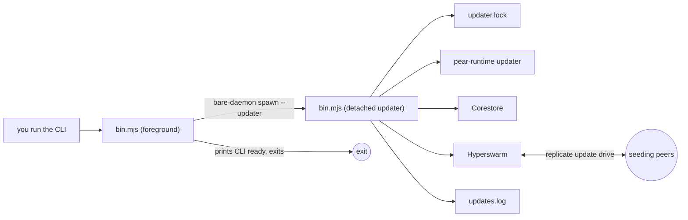

This is the short-lived-CLI counterpart to [Start from the hello-pear-bare template](/p2p/getting-started/from-a-template/start-from-hello-pear-bare). Instead of a long-running process that owns the update check, you start from a boilerplate where the command you type does its work and exits—while a detached updater process carries on in the background. The "daemon" in the name is that updater, not your program.

[`holepunchto/hello-pear-daemon`](https://github.com/holepunchto/hello-pear-daemon) is Holepunch's official boilerplate for CLIs that shouldn't wait on the network, like `git`. It embeds [`pear-runtime`](/pear/reference/pear/runtime) into a standalone [Bare](/bare/reference/bare/modules) executable, but runs the runtime in a detached [`bare-daemon`](https://github.com/holepunchto/bare-daemon) process that the foreground command spawns and returns from immediately. The application and runtime compile into a single executable per OS and architecture with no peer dependencies—no Node.js, and no Bare or [Pear CLI](/pear/reference/pear/cli) required on the user's machine.

<include>../../../_snippets/_p2p-intro-callout.mdx</include>

Take this path when your program is invoked, does a job, and exits, and you still want it to update itself over the air. If your program stays up—a service, REPL, or TUI—follow the [hello-pear-bare template](/p2p/getting-started/from-a-template/start-from-hello-pear-bare) instead. If you want a desktop app, follow the [hello-pear-electron template](/p2p/getting-started/from-a-template/start-from-hello-pear-electron).

<include>../../../_snippets/_install-pear-cli-callout.mdx</include>

<include>../../../_snippets/_interactive-menu-callout.mdx</include>

## Clone and run

### 1. Clone the repository

You need `npm` (via [Node.js](https://nodejs.org)) and [Bare](https://github.com/holepunchto/bare) on your `PATH`; install Bare with `npm i -g bare-runtime`. Then clone the repository and install dependencies with the following commands:

```bash
git clone https://github.com/holepunchto/hello-pear-daemon
cd hello-pear-daemon
npm install
```

### 2. Create a valid `upgrade` link

The template ships with a placeholder `upgrade` link in `package.json`. Create a real link with [`pear touch`](/pear/reference/pear/cli#pear-touch-flags):

```bash
pear touch
```

This prints a link, for example: `pear://qxenz5wmspmryjc13m9yzsqj1conqotn8fb4ocbufwtz9mtbqq5o`.

### 3. Set the `upgrade` link in `package.json`

Set the `upgrade` field in `package.json` to the link you just created:

```json
"upgrade": "pear://qxenz5wmspmryjc13m9yzsqj1conqotn8fb4ocbufwtz9mtbqq5o"
```

### 4. Run the app

`npm start` runs `bare bin.mjs --no-updates`: the command starts in development mode with over-the-air updates off, so no updater is spawned. It logs `CLI ready.` and exits on its own.

```bash
npm start
```

To exercise the daemon locally, opt back in. The foreground command still prints `CLI ready.` and returns at once, and a detached updater starts in the background:

```bash
npm start -- --updates
```

A development run is unbundled—there is no standalone executable to replace—so that updater only takes its lock, waits out the update window, and exits. It never checks for, downloads, or applies a release. To test an update end to end, use a [standalone build](#build-a-standalone-binary).

<Callout type="warn">
Because the foreground process never constructs [`pear-runtime`](/pear/reference/pear/runtime), an unreplaced placeholder `upgrade` link does **not** fail in your terminal when updates are on—the detached updater writes `INVALID_URL` to `<storage>/updates.log` instead. Check that file first whenever updates appear not to run.
</Callout>

## Map the template

| Path | What it is | Do you edit it? |
| --- | --- | --- |
| [`bin.mjs`](https://github.com/holepunchto/hello-pear-daemon/blob/main/bin.mjs) | The entrypoint—parses CLI flags, resolves the storage path, spawns the updater, and (when launched with the hidden `--updater` flag) runs as the updater itself. | Yes—your commands and startup. |
| [`app.js`](https://github.com/holepunchto/hello-pear-daemon/blob/main/app.js) | The `App` class (a [`ready-resource`](https://github.com/holepunchto/ready-resource)). Spawns the detached updater with `bare-daemon`, and inside it owns the [Corestore](/p2p/reference/helpers/corestore), [Hyperswarm](/p2p/reference/building-blocks/hyperswarm), and `PearRuntime` instances. | Sometimes—updater lifecycle. |
| [`package.json`](https://github.com/holepunchto/hello-pear-daemon/blob/main/package.json) | App metadata, scripts, the `upgrade` link, and the per-platform `make:*` build targets. | Yes—branding and release link. |
| [`scripts/make.js`](https://github.com/holepunchto/hello-pear-daemon/blob/main/scripts/make.js) | Detects the host OS and architecture and runs the matching `make:` target. | Rarely. |
| [`test/index.js`](https://github.com/holepunchto/hello-pear-daemon/blob/main/test/index.js) | The [`brittle`](https://github.com/holepunchto/brittle) test entry, run by `npm test`. | Yes—your tests. |

Unlike [hello-pear-bare](/p2p/getting-started/from-a-template/start-from-hello-pear-bare), there is no `workers/` directory and no IPC between processes. The updater is the same executable launched a second time, so `bin.mjs` plays two roles: the command you run, and the background updater it spawns. Your "frontend" is the terminal.

## How it's wired

The template is two layers: `bin.mjs` (entry + CLI, in both roles) and `app.js` (the `App` that spawns and runs the updater).

`bin.mjs` is the Bare entry process. It parses its flags with [`paparam`](https://github.com/holepunchto/paparam)—`--version`, `--storage`, `--no-updates`, `--update-window`, and a hidden `--updater`:

```js file=<rootDir>/examples/getting-started/hello-pear-daemon/bin.mjs#L15-L23 title="bin.mjs"
```

It resolves a storage directory. In development (launched with `bare`) that is a temporary directory, `<os.tmpdir()>/pear/<productName || name>`; a packaged binary uses the persistent per-app directory from [`bare-storage`](/bare/reference/bare/modules), and `--storage` overrides both—see [Storage and distribution](/pear/explanation/storage-and-distribution). Then one `if` picks the role—the updater when `--updater` is set, otherwise the foreground command:

```js file=<rootDir>/examples/getting-started/hello-pear-daemon/bin.mjs#L43-L46 title="bin.mjs"
```

The foreground path is short. Unless updates are disabled it spawns the updater, prints `CLI ready.`, and falls off the end of the file—nothing keeps the process alive, so it exits:

```js file=<rootDir>/examples/getting-started/hello-pear-daemon/bin.mjs#L48-L59 title="bin.mjs"
```

`App.spawnUpdater` re-invokes the same executable through [`bare-daemon`](https://github.com/holepunchto/bare-daemon), passing the hidden `--updater` flag, the resolved `--storage` directory, and `--update-window` when you set one. In development there is no standalone binary, so it also passes the script path (`Bare.argv[1]`) for `bare` to run:

```js file=<rootDir>/examples/getting-started/hello-pear-daemon/app.js#L11-L18 title="app.js"
```

The second invocation takes the `--updater` branch. It constructs an `App` with updates on, logs to `<storage>/updates.log` instead of stdout—nothing is attached to read it—and turns the `App`'s `updating`, `updating-delta` (download progress), `updated`, `update-applied`, and `error` events into log lines. The `SIGHUP`, `SIGINT`, `SIGQUIT`, and `SIGTERM` handlers call `app.exit()` so the daemon closes cleanly:

```js file=<rootDir>/examples/getting-started/hello-pear-daemon/bin.mjs#L62-L82 title="bin.mjs"
```

Inside the daemon, `App` opens a [Corestore](/p2p/reference/helpers/corestore) and a [Hyperswarm](/p2p/reference/building-blocks/hyperswarm) and hands both to `PearRuntime`, then joins the swarm on the update drive's discovery key as a client only—it downloads releases and doesn't announce itself as a source. When the runtime reports a finished download, `App` applies it automatically. For the model behind these updates, see [Pear OTA](/pear/reference/pear/runtime#updates).



### One updater at a time

The daemon takes an exclusive lock on `updater.lock` in the storage directory, via [`fs-native-extensions`](https://github.com/holepunchto/fs-native-extensions). If another updater already holds it, the new one returns without doing anything—so a script that runs your CLI in a tight loop spawns extra daemons that exit immediately instead of racing each other over the same storage.

```js file=<rootDir>/examples/getting-started/hello-pear-daemon/app.js#L139-L144 title="app.js"
```

### How long the daemon waits

`--update-window` (default `30000`, in milliseconds, set by `updater(wait = 30_000)` in `app.js`) bounds only how long the daemon waits for a download to **start**. The clock starts once the `App` is ready, so peer discovery and reading the release manifest count against it. Starting a download clears the timer:

```js file=<rootDir>/examples/getting-started/hello-pear-daemon/app.js#L65-L70 title="app.js"
```

If no download starts in the window, the timer fires and the daemon closes. Once one starts, the daemon stays alive until the update is applied or errors out, however long that takes:

```js file=<rootDir>/examples/getting-started/hello-pear-daemon/app.js#L158-L172 title="app.js"
```

The daemon holds the exclusive `updater.lock` for that whole time. If a download hangs, later runs find the lock taken and quietly do nothing; stop the stuck process and the OS releases the lock.

Give a run longer to pick up a download before the daemon gives up—in a standalone build, since a development run never starts one:

```bash
./out/<platform>-<arch>/<name> --update-window 60000
```

The value must be a non-negative integer. Something else, like `abc` or `1.5`, prints an error and exits with code `1`.

## Build a standalone binary

`npm run make` compiles `bin.mjs` and its dependencies into a single standalone executable with no peer dependencies—users don't need Node.js, Bare, or the [Pear CLI](/pear/reference/pear/cli) installed. `scripts/make.js` detects your OS and architecture and runs the matching `make:<platform>-<arch>` target, which writes an unsigned binary into `out/<platform>-<arch>/`; the template ships a target for every supported platform (macOS, Linux, and Windows, each for `arm64`/`x64`). Unlike the [hello-pear-bare builder](/p2p/getting-started/from-a-template/start-from-hello-pear-bare#build-a-standalone-binary), it ignores `HOST` and the signing variables, so `HOST=linux-arm64 npm run make` still builds for your own host. To build for another target, run that target's script directly, such as `npm run make:linux-x64`. The binary is unsigned either way.

Updates are applied by standalone builds only. A development run is unbundled, so it never checks for or replaces anything—see [Run the app](#4-run-the-app).

See [Bundle a Bare app](/bare/how-to/run-on-native/bundle-a-bare-app#standalone-executable-with-bare-build) for what `npm run make` runs under the hood—[`bare-build`](https://github.com/holepunchto/bare-build), the same tool behind any standalone Bare executable, Pear app or not.

## Install over the air

Distribute the executable through the usual channels—a download on your website, for example.
You can also install it peer-to-peer: once your `upgrade` link is [seeding](/pear/explanation/availability-and-blind-peering#seeding-with-pear-seed) a release, pull it directly with the [`pear install`](/pear/reference/pear/cli#pear-install) command:

```bash
pear install pear://<key>
```

After the first install, new releases reach users through the swarm—no reinstall needed. Each invocation of the installed command spawns the detached updater, so the next run after an update is applied is the new version. The updater swaps the new executable in for the old one, so the user running it needs write access to where it's installed. A package-manager install that puts the binary in a root-owned directory, like `apt` does, can't update itself: the swap fails with a permission error in `updates.log`. For how staging and seeding work, see [Deploy your application](/pear/how-to/operate-an-app/manual-deployment/deployment) and [Installing applications](/pear/explanation/storage-and-distribution#installing-applications).

## Example: add a flag

The boilerplate is a minimal CLI plus updater; `bin.mjs` holds the CLI and startup logic. Flags are parsed with `paparam`, so adding one is a two-line change. Add a `--name` flag to the command definition:

```diff
   flag('--update-window <ms>', 'updater wait in milliseconds'),
+  flag('--name <name>', 'who to greet on startup'),
   flag('--updater', 'run updater daemon').hide()
```

Then log the greeting before the `CLI ready.` line:

```diff
+if (cmd.flags.name) console.log(`Hello, ${cmd.flags.name}!`)
+
 console.log('\nCLI ready.\n')
```

Run `npm start -- --name YourName`, and the command greets you and exits. That is the foreground layer; whatever your CLI actually does goes there, ahead of the exit. The updater needs no changes—it never touches your command's logic.

<Callout type="info">
This template has no worker, so it doesn't include the [`hello-pear-worker`](https://github.com/holepunchto/hello-pear-worker) backend that [hello-pear-bare](/p2p/getting-started/from-a-template/start-from-hello-pear-bare) inlines in `workers/main.js`. The only peer-to-peer code here is the update client, and it dies with the daemon. If your app needs its own [Corestore](/p2p/reference/helpers/corestore) cores or [Hyperswarm](/p2p/reference/building-blocks/hyperswarm) topics to stay up between commands, start from hello-pear-bare instead.
</Callout>

## Customize for your brand

Before you ship, set your identity in `package.json`:

- `name`, `productName`, `description`, `author`, and `license`. The template currently ships `hello-pear-bare` as its `name`, so rename it—along with the `--name` in each `make:*` script, the `repository` and `bugs` URLs, and the `hello-pear-bare` paths in `.github/workflows/build.yaml`.
- the `upgrade` `pear://` link (see [Create a valid upgrade link](#2-create-a-valid-upgrade-link)).

Pick the name carefully, because two tools read it differently. `bin.mjs` uses `productName || name`, exactly as written, for the command name, the persistent storage directory, and the file name the updater looks for in your release—`by-arch/<host>/app/<name>`, plus `.exe` on Windows. [`bare-build`](https://github.com/holepunchto/bare-build) names the binary after `--name` (or `productName || name` when you drop the flag), but turns anything other than letters and digits into a hyphen, adds a hyphen before a capital that follows a lowercase letter or digit, and lowercases the result: `My CLI`, `MyCLI`, and `my_cli` all build `my-cli`. So use lowercase letters, digits, and hyphens for `name` and any `productName`, and give each `--name` the same value or delete it. If the names differ, the updater can't find the binary and logs `update not found` to `updates.log`.

Set these before your first release, then build with `npm run make` and release with [Deploy your application](/pear/how-to/operate-an-app/manual-deployment/deployment).

## Troubleshooting

- **No update happens.** Check four things: `package.json` has a real `upgrade` link; peers are seeding the drive it points to; the release's `package.json` has a higher `version` than the binary you're running; and you're running a [standalone build](#build-a-standalone-binary) without `--no-updates`. `npm start` never applies an update.
- **No error in the terminal, but something is wrong.** The updater has no terminal. Read `<storage>/updates.log` for startup and updater errors—including `INVALID_URL` from an unreplaced placeholder link. In development `<storage>` is a temporary directory that's easy to lose; pass `--storage <dir>` to pin it somewhere you can find it.
- **`updates.log` is empty.** That's normal: the daemon only logs updates and errors, and a lapsed update window logs nothing. An empty log after the daemon has exited means no download started within `--update-window`. Raise it, or check that a peer is seeding the `upgrade` link. If a download did start and then failed, look for `[app:error]`.
- **The update downloads but doesn't apply.** The updater replaces the executable in place, so the user running it needs write access to where it's installed. A failed swap, such as `EACCES` in a read-only directory, is logged to `updates.log` as `[app:error]`.
- **`update not found` in `updates.log`.** The file name the updater asks for doesn't match the binary in your release. See [Customize for your brand](#customize-for-your-brand).
- **`npm run make` fails on your host.** Run a specific `make:<platform>-<arch>` script, or build on a supported host.

## Where to go next

- [Start from a template](/p2p/getting-started/from-a-template)—all the boilerplates, side by side.
- [Start from the hello-pear-bare template](/p2p/getting-started/from-a-template/start-from-hello-pear-bare)—the long-running terminal counterpart, with a Bare worker that holds your peer-to-peer code.
- [Start from the hello-pear-electron template](/p2p/getting-started/from-a-template/start-from-hello-pear-electron)—the desktop counterpart, with a renderer, preload bridge, and Bare worker.
- [Inside Bare](/bare/explanation/bare-runtime)—what the runtime this template builds on actually is, and its lifecycle.
- [Bundle a Bare app](/bare/how-to/run-on-native/bundle-a-bare-app)—the `bare-pack` and `bare-build` paths behind `npm run make`.
- [Pear OTA](/pear/reference/pear/runtime)—the `pear-runtime` API behind the updater.
- [Migrate from pear run to Pear OTA](/pear/how-to/operate-an-app/migration)—if you're moving an existing app onto `pear-runtime`.
- [Publish with GitHub Actions](/pear/how-to/operate-an-app/github-actions/publish-with-github-actions)—stage a stable `pear://` link on every push with the `pear-ci` action.
- [Deploy your application](/pear/how-to/operate-an-app/manual-deployment/deployment)—the full-control manual path for staging, provisioning, and release lines.
- [Seeding with `pear seed`](/pear/explanation/availability-and-blind-peering#seeding-with-pear-seed)—keep your `pear://` link online so peers can fetch releases.
