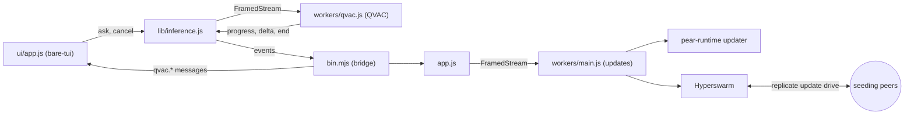

This is the on-device AI counterpart to [Start a terminal app from the hello-pear-bare template](/p2p/getting-started/from-a-template/start-from-hello-pear-bare). It starts from the same shape—a Bare CLI that updates itself over the air through a worker—and adds a second worker that runs a language model **on the user's own machine**, plus a [`bare-tui`](https://github.com/holepunchto/bare-tui) terminal interface. There is no API key and no cloud round-trip, and it keeps working offline once the model is cached.

[`holepunchto/hello-pear-qvac-tui`](https://github.com/holepunchto/hello-pear-qvac-tui) is Holepunch's official boilerplate for this shape. The plumbing—CLI, workers, and IPC—is finished; the chat interface on top is only a demo, meant to be replaced with your own app.

<include>../../../_snippets/_p2p-intro-callout.mdx</include>

Take this path when you want a terminal app that runs a model locally and updates over the air. If you already have an app built from hello-pear-bare and want to add on-device inference to it, follow the how-to [Build a local AI chat TUI with QVAC](/bare/how-to/add-on-device-ai/build-a-local-ai-chat-tui-with-qvac) instead. For a terminal app with no AI, start from [hello-pear-bare](/p2p/getting-started/from-a-template/start-from-hello-pear-bare).

<include>../../../_snippets/_install-pear-cli-callout.mdx</include>

<include>../../../_snippets/_interactive-menu-callout.mdx</include>

## Clone and run

### 1. Clone the repository

You need `npm` (via [Node.js](https://nodejs.org)) and [Bare](https://github.com/holepunchto/bare) on your `PATH`. Install Bare with `npm i -g bare-runtime`, then clone the repository and install its dependencies:

```bash
git clone https://github.com/holepunchto/hello-pear-qvac-tui
cd hello-pear-qvac-tui
npm install
```

The upstream README says the template runs on macOS, Linux, and Windows, each for `arm64` and `x64`, and that QVAC ships native prebuilds for all of them and uses GPU acceleration (Vulkan or Metal) where it exists.

### 2. Run the app

`npm start` runs `bare bin.mjs --no-updates`: the app starts with over-the-air updates off. The first run downloads about 1 GB of model weights and caches them, according to the upstream README, so it takes a while; later runs start in seconds.

```bash
npm start
```

Ask a question and the answer streams back. These keys work in the interface:

| Key | Does |
| --- | --- |
| `↵` | Send the question. |
| `esc` | Interrupt the answer being generated. |
| `ctrl+t` | Show or hide a thinking model's reasoning. |
| `pgup` / `pgdn` | Scroll the transcript; the mouse wheel works too. |
| `ctrl+c` | Interrupt if the model is busy, otherwise quit. |

### 3. Pick a model and a context window

Two flags matter, and `bin.mjs` defines them next to the usual `--storage`, `--no-updates`, and `--version`:

```js file=<rootDir>/examples/how-to/add-on-device-ai/hello-pear-qvac-tui/bin.mjs#L17-L26 title="bin.mjs"
```

`--model` takes any model constant exported by [`@qvac/inference`](https://www.npmjs.com/package/@qvac/inference), and nothing else changes. `--ctx` sets the context window in tokens, the budget that the conversation, the model's reasoning, and the answer share. The defaults live in `package.json`:

```json file=<rootDir>/examples/how-to/add-on-device-ai/hello-pear-qvac-tui/package.json#L55-L58 title="package.json"
```

The upstream README warns that the QVAC addon's own default context is only 1024 tokens, small enough that a couple of turns leave no room to answer, which is why the template sets `8192`. See its [list of models that work out of the box](https://github.com/holepunchto/hello-pear-qvac-tui#models-that-work-out-of-the-box):

```bash
npm start -- --model QWEN3_1_7B_INST_Q4 --ctx 16384
```

## Map the template

| Path | What it is | Do you edit it? |
| --- | --- | --- |
| [`bin.mjs`](https://github.com/holepunchto/hello-pear-qvac-tui/blob/main/bin.mjs) | The entrypoint—parses flags, starts both workers, and is the only place the workers meet the interface. | Yes—your startup and CLI. |
| [`ui/app.js`](https://github.com/holepunchto/hello-pear-qvac-tui/blob/main/ui/app.js) and [`ui/transcript.js`](https://github.com/holepunchto/hello-pear-qvac-tui/blob/main/ui/transcript.js) | The whole interface: a plain `bare-tui` model with state, keys, and layout, and the drawing of one conversation entry. It never imports the QVAC SDK. | Yes—replace this first. |
| [`lib/inference.js`](https://github.com/holepunchto/hello-pear-qvac-tui/blob/main/lib/inference.js) | The client for the inference worker. | Rarely. |
| [`workers/qvac.js`](https://github.com/holepunchto/hello-pear-qvac-tui/blob/main/workers/qvac.js) | The inference [worker](/pear/explanation/workers): loads the model and streams tokens. | Yes—change what you ask the model. |
| [`app.js`](https://github.com/holepunchto/hello-pear-qvac-tui/blob/main/app.js) | The client for the update worker. It stages a release and applies it only when the interface asks. | Sometimes. |
| [`workers/main.js`](https://github.com/holepunchto/hello-pear-qvac-tui/blob/main/workers/main.js) | The update worker, the shared [`hello-pear-worker`](https://github.com/holepunchto/hello-pear-worker). | No. |
| [`package.json`](https://github.com/holepunchto/hello-pear-qvac-tui/blob/main/package.json) | Metadata, scripts, the `upgrade` link, and the default model and context. | Yes—branding and release link. |
| [`scripts/make.js`](https://github.com/holepunchto/hello-pear-qvac-tui/blob/main/scripts/make.js) | Builds the standalone binary for the host. | Rarely. |
| [`test/index.js`](https://github.com/holepunchto/hello-pear-qvac-tui/blob/main/test/index.js) | Headless [`brittle`](https://github.com/holepunchto/brittle) tests that need no model and no GPU, run by `npm test`. | Yes—your tests. |

The repository also ships a [`CLAUDE.md`](https://github.com/holepunchto/hello-pear-qvac-tui/blob/main/CLAUDE.md) that explains how to extend the template and the traps it has already hit. Point your coding agent at it before asking for changes.

## How it's wired

There are two workers and one pattern. Each runs in its own Bare thread through [`PearRuntime.run`](/pear/reference/pear/runtime#running-workers) and is spoken to over a `FramedStream`. The upstream README explains that loading a model file blocks its thread for seconds, so inference gets a worker of its own instead of freezing the interface. `bin.mjs` constructs the two clients side by side:

```js file=<rootDir>/examples/how-to/add-on-device-ai/hello-pear-qvac-tui/bin.mjs#L50-L63 title="bin.mjs"
```

`lib/inference.js` is deliberately the same shape as `app.js`: a [`ready-resource`](https://github.com/holepunchto/ready-resource) that spawns its worker and turns the frames it receives into events. Learn one and you know the other:

```js file=<rootDir>/examples/how-to/add-on-device-ai/hello-pear-qvac-tui/lib/inference.js#L22-L60 title="lib/inference.js"
```



An answer takes this path: the interface asks `lib/inference.js`, which sends an `ask` frame to the worker; the worker streams `delta` frames back; `bin.mjs` turns each one into a message for the interface; and a final `end` frame settles it. The load-bearing rule is that `ui/app.js` never imports the QVAC SDK, which is why the tests run headless in a fraction of a second. The how-to [Build a local AI chat TUI with QVAC](/bare/how-to/add-on-device-ai/build-a-local-ai-chat-tui-with-qvac#how-one-question-flows) walks through every layer and the full frame protocol.

## Updates

Updates are off until you give the template a real key. With the placeholder `upgrade` link still in `package.json`, `bin.mjs` skips the updater instead of letting it throw inside the worker, and says so in the transcript when you start with `--updates`:

```js file=<rootDir>/examples/how-to/add-on-device-ai/hello-pear-qvac-tui/bin.mjs#L43-L48 title="bin.mjs"
```

Create a link with [`pear touch`](/pear/reference/pear/cli#pear-touch-flags), set `upgrade` in `package.json`, and start with updates on:

```bash
npm start -- --updates
```

Unlike hello-pear-bare, this template never swaps the build out from under a conversation. `app.js` stages a release but does not apply it, and a banner in the interface asks first. `ctrl+r` applies the staged update, and `esc` dismisses the banner while the model isn't answering. `bin.mjs` hands the banner its apply callback:

```js file=<rootDir>/examples/how-to/add-on-device-ai/hello-pear-qvac-tui/bin.mjs#L65-L72 title="bin.mjs"
```

A staged release is not downloaded on sight. The updater waits a random delay of up to an hour so a released fleet doesn't hit the seeder at once, and the interface tells you when one is scheduled. Restart the app to claim it sooner. For the model behind these updates, see [Pear OTA](/pear/reference/pear/runtime#updates).

## Build a standalone binary

`npm run make` builds a standalone executable for your host into `out/make`, named `hello-pear-qvac` (plus `.exe` on Windows). `HOST=linux-arm64 npm run make` targets another supported platform, and macOS and Windows signing read the same environment variables as the [hello-pear-bare builder](/p2p/getting-started/from-a-template/start-from-hello-pear-bare#build-a-standalone-binary). The per-platform `make:<platform>-<arch>` scripts in `package.json` build unsigned binaries into `out/<platform>-<arch>`. The upstream README says the model weights are downloaded on the first run, so plan for that wait and download in a built app too.

Release it the same way as any Pear app: stage, provision, and seed with [Deploy your application](/pear/how-to/operate-an-app/manual-deployment/deployment), then install over the air with [`pear install`](/pear/reference/pear/cli#pear-install). See [Installing applications](/pear/explanation/storage-and-distribution#installing-applications) for how installs work.

## Customize for your brand

Before you ship, set your identity in `package.json`:

- `name`, `productName`, `description`, `author`, and `license`. The template ships `hello-pear-qvac` as its `name`, and that name is also written into `scripts/make.js`, each `make:*` script, and `.github/workflows/build.yaml`. Change it in all of them.
- the `upgrade` `pear://` link (see [Updates](#updates)).

Pick the name carefully, because two tools read it differently. `bin.mjs` hands the updater `productName || name` exactly as written, plus `.exe` on Windows, and the updater looks for that file name in your release at `by-arch/<host>/app/<name>`. [`bare-build`](https://github.com/holepunchto/bare-build) lowercases the `--name` it is given and turns anything other than letters and digits into hyphens, so `My Chat` and `MyChat` both build `my-chat`. Use lowercase letters, digits, and hyphens everywhere, and keep every copy of the name identical. If they differ, the updater can't find the binary and reports `update not found`.

## Remix it

Chat is only the demo. Most ideas need no new dependency—just a different prompt and output shape in `ask()` in `workers/qvac.js`—and the how-to's [Remix it](/bare/how-to/add-on-device-ai/build-a-local-ai-chat-tui-with-qvac#remix-it) section lists a few. The upstream README's [Remix it](https://github.com/holepunchto/hello-pear-qvac-tui#remix-it) section goes further: swapping the QVAC plugin for another modality, using just the SDK, and deleting the updater or the interface when you don't need them.

## Troubleshooting

- **Stuck at 0% on the first run.** The model is downloading, about 1 GB according to the upstream README. The percentage moves as blocks arrive.
- **Answers stop mid-sentence, and get worse each turn.** The context window is full. Raise `--ctx`.
- **`ggml_vulkan: …` lines appear over the interface.** llama.cpp writes to the error stream below any JavaScript logger, and `bin.mjs` repaints the screen. It is harmless.
- **The app hangs on exit.** The model must be unloaded first. That is the worker's `close` handshake, and quitting gives it a short grace period before giving up.
- **An update downloaded but nothing happened.** The confirm gate is waiting: press `ctrl+r`, then relaunch to run the new build.
- **Out of memory, or only a few tokens per second.** Pick a smaller model or quantization with `--model`.

## Where to go next

- [Start from a template](/p2p/getting-started/from-a-template)—all the boilerplates, side by side.
- [Build a local AI chat TUI with QVAC](/bare/how-to/add-on-device-ai/build-a-local-ai-chat-tui-with-qvac)—the how-to behind this template: what it adds to hello-pear-bare and how a question flows end to end.
- [Start a terminal app from the hello-pear-bare template](/p2p/getting-started/from-a-template/start-from-hello-pear-bare)—the template this one extends, with the update worker explained in full.
- [Workers](/pear/explanation/workers)—why peer-to-peer and inference code run in their own threads.
- [Pear OTA](/pear/reference/pear/runtime)—the `pear-runtime` API behind the updater.
- [Deploy your application](/pear/how-to/operate-an-app/manual-deployment/deployment)—the full-control manual path for staging, provisioning, and release lines.
- [Seeding with `pear seed`](/pear/explanation/availability-and-blind-peering#seeding-with-pear-seed)—keep your `pear://` link online so peers can fetch releases.
