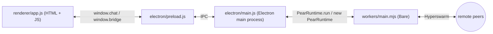

import { Tabs, Tab } from 'fumadocs-ui/components/tabs'
import { Cards, Card } from 'fumadocs-ui/components/card'

Pear is an installable peer-to-peer runtime, development, and deployment platform. Apps built on it find each other and exchange data directly—no server in the middle—and they update themselves over the same peer-to-peer swarm they run on.

This page is the path from nothing to a released app: install the `pear` CLI, build a first app, and ship it. Each section points into the page that does the work. If you already have an app and only need to release it, skip to [Already have an app? Ship it](#already-have-an-app-ship-it).

<include>../../_snippets/_p2p-intro-callout.mdx</include>

## Install Pear

Get the [`pear`](/pear/reference/pear/cli) CLI from **[install.pears.com](https://install.pears.com)**:

<Tabs items={['curl (macOS / Linux)', 'irm (Windows)', 'brew (macOS / Linux)', 'npx', 'docker']}>
<Tab value="curl (macOS / Linux)">
```sh
curl https://install.pears.com/pear.sh | sh
```
</Tab>
<Tab value="irm (Windows)">
```powershell
irm https://install.pears.com/pear.ps1 | iex
```
</Tab>
<Tab value="brew (macOS / Linux)">
```sh
brew install pear
```
</Tab>
<Tab value="npx">
```sh
npx pear
```
</Tab>
<Tab value="docker">
```sh
docker run -it --rm tetherto/pear
```
</Tab>
</Tabs>

Follow the `PATH` instructions the installer prints, then run `pear` directly. See [Install & upgrade](/pear/reference/pear/cli#install) for the Homebrew and npm-global notes and upgrade details. The [`tetherto/pear`](https://hub.docker.com/r/tetherto/pear) image runs Pear inside Ubuntu with `pear` and `pear-install` ready to go—handy for trying the CLI without installing anything locally.

<include>../../_snippets/_interactive-menu-callout.mdx</include>

You only need the CLI to ship. Building and running an app locally works with Node.js and npm alone, so if you'd rather see something working first, go straight to [Build your first app](#build-your-first-app) and come back.

## Build your first app

There are two ways in. Both end at the same place: an Electron desktop app in the shape of the official [`hello-pear-electron`](https://github.com/holepunchto/hello-pear-electron) template, ready to [ship](#ship-it).

### Type along: build a peer-to-peer chat

The recommended path if Pear is new to you. Four parts, each a single sitting, each starting from the previous part's code. You write every file yourself, so by the end you know where everything lives and why.

<Cards>
  <Card
    href="/pear/getting-started/build-a-peer-to-peer-chat/build-a-peer-to-peer-chat"
    title="Part 1 — Build a peer-to-peer chat"
    description="Five files, about 15 minutes. Two windows find each other on the public DHT and stream messages directly."
  />
  <Card
    href="/pear/getting-started/build-a-peer-to-peer-chat/reshape-into-a-production-app"
    title="Part 2 — Reshape into a production app"
    description="Grow part 1 into the hello-pear-electron scaffold: a Bare chat worker, an Autobase room with invites, on-disk persistence, and a separate updater worker."
  />
  <Card
    href="/pear/getting-started/build-a-peer-to-peer-chat/ship"
    title="Part 3 — Ship your app"
    description="pear touch, electron-forge make, pear build, and pear stage to publish your first version."
  />
  <Card
    href="/pear/getting-started/build-a-peer-to-peer-chat/update"
    title="Part 4 — Deploy over-the-air updates"
    description="Run the installed app, ship a second version, and watch the update arrive from the swarm."
  />
</Cards>

#### What you'll build

A small Electron window with a message list, an input, and a peer counter. Two instances on the same machine—or on different machines anywhere on the public internet—discover each other through the [DHT](/p2p/reference/building-blocks/hyperdht) and stream messages directly.



Each part adds one layer to that picture:

- Part 1 wires the renderer ↔ main ↔ worker ↔ peers path with the smallest amount of code.
- Part 2 reshapes that into the full [`hello-pear-electron`](https://github.com/holepunchto/hello-pear-electron) production scaffold: a dedicated Bare chat worker, an [Autobase](/p2p/reference/building-blocks/autobase)-backed room with [blind-pairing](https://www.npmjs.com/package/blind-pairing) invites, a HyperDB schema, on-disk persistence, a separate OTA updater worker, and a polished Tailwind UI—the vanilla renderer that every peer-to-peer how-to extends.
- Part 3 turns the project into a release pipeline: signed distributables, a `pear://` upgrade link, and the first published version on a [Hypercore](/p2p/reference/building-blocks/hypercore).
- Part 4 puts that release pipeline in motion: run the installed app, ship a second version, watch OTA fire end-to-end, and preview the production `stage → provision → multisig` flow from the [release pipeline](/pear/explanation/deployment-releasing-apps-p2p).

#### Before you start

- [Node.js](https://nodejs.org/) v22.17 or newer and npm v10.9 or newer
- A POSIX-style terminal (macOS, Linux, or Windows with WSL)
- An IDE or text editor
- The [`pear`](/pear/reference/pear/cli) CLI—[installed above](#install-pear); only required for parts 3 and 4

Each part lists any extra npm packages it adds.

### Or start from a template

Already comfortable with Electron, Bare, or React Native? Clone an official boilerplate and learn your way around it instead. Each one embeds a `pear-runtime`-family module for peer-to-peer over-the-air updates, so [Ship it](#ship-it) applies as soon as you've made it yours. [Start from a template](/pear/getting-started/from-a-template) compares them; these are the five:

<Cards>
  <Card
    href="/pear/getting-started/from-a-template/start-from-hello-pear-electron"
    title="hello-pear-electron (desktop)"
    description="An Electron GUI app: renderer ↔ main ↔ Bare worker behind a preload bridge. The shape Keet and PearPass ship."
  />
  <Card
    href="/pear/getting-started/from-a-template/start-from-hello-pear-bare"
    title="hello-pear-bare (long-running terminal)"
    description="A standalone Bare executable for long-running programs: services, REPLs, and TUIs with no GUI and no peer dependencies."
  />
  <Card
    href="/pear/getting-started/from-a-template/start-from-hello-pear-daemon"
    title="hello-pear-daemon (short-lived CLI)"
    description="A standalone Bare executable for commands that run and exit: a detached bare-daemon updater checks for updates in the background after the command returns."
  />
  <Card
    href="/pear/getting-started/from-a-template/start-from-hello-pear-qvac-tui"
    title="hello-pear-qvac-tui (on-device AI terminal)"
    description="A terminal app that runs a language model on the user's own machine: Bare, QVAC on-device inference, and a bare-tui interface, with over-the-air updates."
  />
  <Card
    href="/pear/getting-started/from-a-template/start-from-hello-pear-react-native"
    title="hello-pear-react-native (mobile)"
    description="An Expo/React Native app: a Bare worklet embedded via pear-mobile, with the same over-the-air updates."
  />
</Cards>

Want the building blocks without an app around them? The [P2P tab's Getting started](/p2p/getting-started) connects two plain Node.js or Bare processes with Hyperswarm and replicates data with Hypercore—no Pear involved.

## Ship it

Parts 3 and 4 of the tutorial walk through a first release end to end. Once you've done it once, the deeper how-tos cover every part of the pipeline:

- [Deploy your application](/pear/how-to/operate-an-app/manual-deployment/deployment)—`pear touch`, `pear stage`, `pear provision`, and `pear seed`, the core stage → provision → seed flow.
- [Build & package](/pear/how-to/operate-an-app/build-and-package)—desktop distributables, binaries, and app-store submissions.
- [CI/CD with GitHub Actions](/pear/how-to/operate-an-app/github-actions)—automate the same flow from CI.
- [Multisig](/pear/how-to/operate-an-app/multisig)—require multiple signers before a production release goes live.

For the concepts behind that flow—what staging, provisioning, and multisig actually do and why there's no server—read [Release pipeline](/pear/explanation/deployment-releasing-apps-p2p).

## Already have an app? Ship it

If your app exists and you're here to release it, the how-tos under [Ship it](#ship-it) are the whole path. Two cases need one extra page first:

- **Built on Electron or React Native, but not on Pear yet**—[Integrate Pear OTA into an existing app](/pear/how-to/operate-an-app/integrate-pear-ota) adds the `pear-runtime` updater without restructuring your app.
- **Built on Pear v1 or v2 (`pear run`)**—[Migrate from pear run to Pear OTA](/pear/how-to/operate-an-app/migration) moves you onto the embeddable runtime that v3 requires.

## Where to go next

- [About Pear](/pear/explanation)—how the pieces fit, where data lives, and why Pear is shaped the way it is.
- [Pear desktop application architecture](/pear/explanation/pear-desktop-architecture)—why Bare workers, the preload bridge, and the OTA updater look the way they do.
- [Command Line Interface (CLI)](/pear/reference/pear/cli)—every `pear` command and flag.
- [Manage installed applications](/pear/how-to/manage-installed-applications)—list installed Pear apps and reset their storage.
- [Troubleshoot common issues](/pear/how-to/troubleshooting)—fixes for common Pear CLI and deployment issues.
