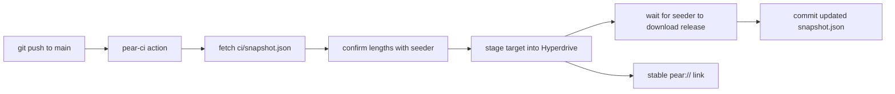

The simplest way to publish and update a Pear app is to let CI do it. The [`pear-ci` GitHub Action](https://github.com/holepunchto/actions/blob/main/pear-ci/action.yml) stages a directory from your repository into a [Hyperdrive](/p2p/reference/building-blocks/hyperdrive) on every push, so shipping a new version is just a `git push`. There is no local `pear touch` or `pear stage` to run by hand. You do need one peer that stays online: every run waits for a peer that holds the drive before it stages, and for a peer to download the new release after, so keep [`pear seed`](/pear/reference/pear/cli#pear-seed-link) running on an always-on machine.

This is the goal-oriented recipe. If you need the full-control flow—release lines, provision, and multisig—use [Deploy your application](/pear/how-to/operate-an-app/manual-deployment/deployment) instead. The two are not mutually exclusive: CI is the fast path for development and staging links, while the manual flow gives you production gating.

<include>../../../../_snippets/_install-pear-cli-callout.mdx</include>

## How it works

The action wraps the [`pear-ci`](https://www.npmjs.com/package/pear-ci) tool. On each run it:

1. Installs the latest `pear-ci` from npm and fetches the committed `ci/snapshot.json` from the `main` branch.
2. Joins [Hyperswarm](/p2p/reference/building-blocks/hyperswarm) and waits until a peer that holds the drive reports each core at the length recorded in the snapshot.
3. Mirrors your `target` directory into a [Hyperdrive](/p2p/reference/building-blocks/hyperdrive) whose key is **derived deterministically from `primary-key` + `namespace`**, then waits until a peer holds every block of the drive, the new release included.
4. Commits the updated `ci/snapshot.json` back to `main` (or opens a PR if the push is rejected).

Three properties shape how this works in CI:

- **The `pear://` link is stable.** Because the drive key comes from the secret primary key plus the namespace, every run stages to the same link. You set that link once as your app's `upgrade` field and every push updates it.
- **The snapshot replaces persistent storage.** `ci/snapshot.json` records each core's length, so the next run only syncs what changed instead of re-uploading the whole drive or persisting a full [Corestore](/p2p/reference/helpers/corestore) between jobs.
- **A peer has to hold the drive.** A fresh runner has no copy of the drive, so it depends on a peer twice: before staging, to confirm the lengths the snapshot records, and after staging, to take the new release. Neither wait has a time limit, so a run with no peer online waits until the job times out. An always-on seeder fills that role.



## Before you begin

You need:

1. A GitHub repository for your app, with a branch named `main`.
2. The directory you want to publish committed to that repo—typically the [`pear build`](/pear/how-to/operate-an-app/build-and-package/build-desktop-distributables#build-the-deployment-directory) deployment directory, your app source if you stage the runnable project directly, or a mobile OTA payload's `dist/` (see [Build the OTA payload](/pear/how-to/operate-an-app/manual-deployment/mobile#build-the-ota-payload-steps-34)).
3. A 32-byte hex **primary key** (created below) stored as a repository secret.
4. A **namespace** name (any string of letters, numbers, dots, hyphens, or underscores) that identifies this drive.
5. An always-on machine with Pear installed, to seed the drive (see [Keep a seeder online](#keep-a-seeder-online)).

## Generate and store the primary key

Generate a random 32-byte key:

```bash skip="manual-walkthrough"
openssl rand -hex 32
# 9f2c... (64 hex characters)
```

Add it to your repository as a secret named `PEAR_PRIMARY_KEY` (**Settings → Secrets and variables → Actions → New repository secret**).

<Callout type="warning">
The primary key is the **write key** for your drive—anyone who has it can publish updates that your users will receive over the air. Keep it in a repository (or organization) secret, never commit it, and rotate it if it leaks. Rotating the key changes the derived `pear://` link, so you would need to update the `upgrade` field and re-onboard users.
</Callout>

## Commit an empty snapshot

The action reads `ci/snapshot.json` from a branch named `main` before it stages, and commits the updated file back to `main` after. The action hard-codes the branch name. Before the first run, commit the file with an empty list:

```bash skip="manual-walkthrough"
mkdir -p ci
echo '[]' > ci/snapshot.json
git add ci/snapshot.json
git commit -m "Add the pear-ci snapshot"
git push origin main
```

Without this file, the action's **Fetch snapshot from main** step fails with `gh: Not Found (HTTP 404)`.

<include>../../../../_snippets/_pear-ci-snapshot-reset-callout.mdx</include>

## Add the workflow

Create `.github/workflows/pear-ci.yml`:

```yaml skip="ci-config"
name: Publish with pear-ci

on:
  push:
    branches: [main]

# pear-ci commits the updated snapshot back to main
permissions:
  contents: write
  pull-requests: write

concurrency:
  group: pear-ci
  cancel-in-progress: false

jobs:
  stage:
    runs-on: ubuntu-latest
    # Ends a run that waits for a peer. Keep it well above your largest upload.
    timeout-minutes: 60
    steps:
      - uses: actions/checkout@v4
      - uses: holepunchto/actions/pear-ci@v1
        with:
          primary-key: ${{ secrets.PEAR_PRIMARY_KEY }}
          namespace: my-app
          target: dist
          dry-run: true
```

Set `namespace` to your chosen name and `target` to the repo-relative path of the directory you want to publish. The `concurrency` group prevents two runs from racing to commit `ci/snapshot.json` at the same time. The workflow starts with `dry-run: true`, and you switch it to `false` once a seeder is online.

`timeout-minutes` ends a run that waits for a peer that never comes. Without it, GitHub lets the job run for 360 minutes. Set it well over the time your largest release takes to reach the seeder, so the timeout never ends a run while the seeder is still downloading.

<include>../../../../_snippets/_pear-ci-stopped-run-callout.mdx</include>

Commit the workflow and push it to `main`. That push starts the first run.

For the full list of inputs and outputs, see the [`pear-ci` GitHub Action reference](/pear/reference/ci-and-release/pear-ci-action).

## Dry-run first

With `dry-run: true`, the action computes and logs the file-by-file diff without writing anything to the drive or committing a snapshot—the same safety check as `pear stage --dry-run`. On an empty drive, a dry run needs no peer.

Read the diff in the Actions log. Look for the files you expect, no surprise additions (`.DS_Store`, editor swap files, secrets), and sensible byte counts.

## Wire up the `pear://` link

The dry run prints the drive key it stages to:

```text skip="sample-output"
starting stage for key  <drive-key>
```

That key is your app's `pear://` link. Set it as the [`upgrade`](/pear/reference/pear/configuration) field so installed builds poll it for updates:

```bash skip="manual-walkthrough"
npm pkg set upgrade=pear://<drive-key>
```

This is the same `upgrade` link that the [manual deploy flow](/pear/how-to/operate-an-app/manual-deployment/deployment#1-set-the-upgrade-link) sets—the only difference is that CI now stages to it for you. Because the key is deterministic, you only do this once.

## Keep a seeder online

Before the first real run, start a peer that holds the drive. On a machine that stays online, seed the link and leave it running:

```bash skip="manual-walkthrough"
pear seed pear://<drive-key>
```

The seeder downloads each release while a run stages it. Every later run, dry runs included, first waits for it to report the lengths in `ci/snapshot.json`, so keep it running for as long as you publish from CI. For higher availability, seed the link on more than one machine (see [Seeding with `pear seed`](/pear/explanation/availability-and-blind-peering#seeding-with-pear-seed)).

Then set `dry-run: false` in the workflow, commit, and push. In the job log, **Stage** should end with `all remote peers synced`, and **Commit snapshot to main** should commit the updated `ci/snapshot.json`. Every later push to `main` then stages and publishes automatically, as long as each run's snapshot commit lands on `main`.

If no peer with the drive is online, the log stops at one of these lines:

- `syncing <key> to length <n>`: the run is waiting for the seeder before it stages. It hasn't written anything yet, so stopping it is safe.
- `waiting synced remote peers for key <drive-key>`: the run has staged and is waiting for a peer to download the release. It commits nothing, and only this runner holds the release.

In both cases, start the seeder while the run waits. The run carries on once the seeder connects. If the job timed out while no seeder or other peer was online, re-run the most recent run once the seeder is up.

## When the snapshot lands in a pull request

The action commits the snapshot on top of the commit the run checked out. If someone pushes to `main` during the run, or branch protection blocks direct pushes, the direct push fails, and the action opens a `pear-ci/snapshot-<run-id>` pull request instead. Until you merge it, `main` holds an older snapshot than the drive, so every run fails before it stages with `Core <key> length (<n>) is higher than length in snapshot.json`. Merge the pull request before the next run. Merging is a push to `main`, so it starts a run that stages the latest commit.

## Producing the build to stage

`pear-ci` stages whatever is in `target`—the action itself has no idea whether that directory came from a desktop or a mobile build. To build and sign a desktop directory on CI first, pair it with [`make-pear-app`](/pear/reference/ci-and-release/github-actions#make-pear-app): one job produces signed, notarized distributables (see [Build and sign desktop apps in CI](/pear/how-to/operate-an-app/github-actions/build-and-sign-in-ci)), and `pear-ci` stages the assembled deployment directory to your stable `pear://` link.

<Callout type="info">
For a mobile OTA payload, point `target` at `dist`—the directory [`npm run update`](/pear/how-to/operate-an-app/manual-deployment/mobile#build-the-ota-payload-steps-34) assembles—instead of a desktop deployment directory. There is no equivalent of `make-pear-app` for mobile signing yet, so the build step itself (bundling and `pear build`) still has to run somewhere before `pear-ci` sees `dist`; if you add that as its own CI job, remember the worker bundle is gitignored and needs [an explicit rebuild step](/pear/how-to/operate-an-app/build-and-package/submit-to-app-stores#ios) in CI too, not just before a local `eas build`.
</Callout>

## See also

- [`pear-ci` GitHub Action reference](/pear/reference/ci-and-release/pear-ci-action)—every input, output, and the underlying CLI.
- [Holepunch GitHub Actions](/pear/reference/ci-and-release/github-actions)—the other shared actions, including `make-pear-app`.
- [Build and sign desktop apps in CI](/pear/how-to/operate-an-app/github-actions/build-and-sign-in-ci)—build and sign the artifacts `pear-ci` stages.
- [Deploy your application](/pear/how-to/operate-an-app/manual-deployment/deployment)—the full manual flow with release lines, provision, and multisig.
- [Ship your app](/pear/getting-started/build-a-peer-to-peer-chat/ship)—the type-along walkthrough of staging by hand.
- [Configuration](/pear/reference/pear/configuration)—the `upgrade` field and other `package.json` settings.
- [Release pipeline](/pear/explanation/deployment-releasing-apps-p2p)—the conceptual picture of staging and OTA updates.
- [Troubleshoot desktop releases](/pear/how-to/operate-an-app/manual-deployment/troubleshoot-desktop-releases)—when an update does not reach peers.
